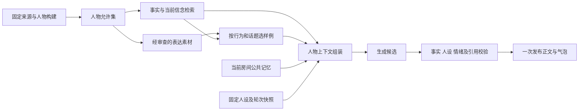

# ChatHaruhi 方法适配与人物聊天质量设计

日期：2026 年 10 月 12 日。状态：设计已纳入主线；T05 表达派生与受限检索已实施，T06/T12 的聊天接入及质量对照待完成。适用范围为已确定的严格原著模式；T01–T04、T15、T18 的已完成记录保持有效。

## 采用方式

目标是分别提升人物提取与取证的准确性、原著表达的忠实度、对当前交流的回应质量。采用 ChatHaruhi 的人物资料整理、相关表达样例和上下文分区方法，适配 Octopus 的 CanonicalScope、模型接口和发布校验。研究来源和固定提交见[参考记录](F:/god/project/Octopus/docs/research/2026-10-12-chatharuhi-reference.md)。下面的存储、预算和验收规则是 Octopus 的设计选择，不是原项目已有的保证。

| 接法 | 收益与代价 | 决策 |
| --- | --- | --- |
| 在现有模块中适配方法 | 可逐步加入表达样例、预算分配和检索改进，复用当前权限、版本、Provider 与消息发布链路 | 首版主线 |
| 固定版本的原项目用于独立对照 | 可比较参考输入组织与当前策略；需要模型接口适配及独立的历史实例 | 可选研究实验，不阻塞首版 |
| 整体接入其运行库 | 需要适配故事数据库、模型初始化、history、失败行为及依赖，并验证每条运行路径的作用域 | 当前不引入生产依赖 |

实际复用代码时固定提交并记录来源及许可证。其角色包、人物 prompt 和模拟对话不能直接成为用户所导入版本的原著依据；导入外部材料时先作为待审资料，仅通过本书证据校验的内容才可进入新的原著构建。

## 提取精度

借鉴小说→场景/对白→人物资料的组织流程，保留现有不可变原文及码点定位。模型生成的梗概、重排文本或系统提示词是候选材料，每个结论仍需回指原文；总结不能替代来源版本。

按四类错误分别评测：人物遗漏及别名错误、对白/心理归属错误、获知授权错误、基线时间或修正错误。对整本书分层抽查开头/中部/尾部、主要/次要人物、对白/旁白、代词及同名情形。抽取覆盖和语义正确性分别报告；上下文中出现人物名不等于本人获知。表达增强不会修复人物提取错误，纠错仍走 T04 的新构建流程。

未来调整提取提示词、样例或策略时保存新配置版本并建立同来源的新构建；既有发布记录不重开、不原地补授权。需要补充缺失的安全引文或 style 断言时也采用新原著构建。

## 事实与表达分别检索

CharacterKnowledgeService 提供 AllowlistedContext，包含人物允许的命题及安全依据；CharacterExpressionService 提供 ExpressionContext，包含表达规则、原著对白样例和出处。二者都使用服务端构造的完整工作区＋B＋character_id。主题和对话行为只影响相关性排序，不产生新授权。

表达规则仅取已有、当前有效且本人可用的 style 断言及其基线；证据不足保持 unknown。对白样例需另确认原文发言者是本人物，不能用其听到的别人的话冒充自身语气。样例正文必须是当前 accepted 可见证据 approved_excerpt 的连续子串，并精确定位回同来源；提供简短场景标签，如“回应质疑”，不复制完整场景。

标签只用于检索，不新增世界观、动机或核心人格。样例如包含事实、关系或信念，必须在当前人物允许集内且与当前基线相容；历史错误信念、已改变的关系和时序不明材料不进入普通表达样例。回顾问题通过知识通道明确标记历史，不用历史样例恢复旧立场。素材出处须标明用于发言者/表达支持还是实际事实；运行时含事实的样例，其事实引用必须已在本次 AllowlistedContext 或已验证的当前基线中，否则舍弃样例。表达素材 ID 不能充当事实引用。

旧构建没有合格安全引文时返回无样例，继续使用已有固定基线与已授权表达规则；不从全书、其他人物或外部角色包填补。需要额外素材时显示可重建提示，通过新版原著构建补充。

读者素材目录可展示已审查的表达材料及原文位置；本次模型预览只展示经过当前问题、事实依据和基线过滤后的选中项。读者能查看某条材料不代表它已进入人物本次上下文。

## 表达素材构建与存储

表达集是已发布原著上的派生索引，允许为旧 B 建立，但不能写 book_claims、book_claim_access、book_access_evidence 或 book_character_baselines。其独立构建状态、配置、检查点和租约不能写入已冻结的原著构建检查点。

T05 新增以下工作区表，实际 DDL 随迁移 19–21 落地，验证见[阶段记录](F:/god/project/Octopus/docs/plans/book-character-agents/validation/2026-10-12-knowledge-expression-validation.md)：

| 表 | 关键字段和关联 | 索引及保护 |
| --- | --- | --- |
| book_expression_sets | id；完整 B＋character_id；material_policy_version、配置/输入指纹、baseline_hash；状态、覆盖/错误、attempts 与租约代数。完整人物复合外键；唯一人物范围＋指纹 | 范围＋状态查询索引；完成后素材与配置固定，生命周期可禁用；重复构建复用同指纹 |
| book_expression_materials | id、set_id、完整 B＋character_id；kind 为 style_rule/dialogue_example；text、dialogue_action、topic_terms、review_state；出处和语义复核结果 | 唯一集合内素材指纹；同范围 set 复合外键；范围＋集合＋类型＋审查状态索引；标签不能升级为基线 |
| book_expression_refs | material_id、set_id、完整 B＋character_id、claim_id、evidence_id、purpose（speaker/style/fact/stance）、片段与子串偏移、原 approved_excerpt 哈希 | 完整复合外键指向素材与 book_access_evidence；必填范围及引用；素材读取索引和父证据反向索引；服务校验 accepted 状态、子串及哈希 |

一条素材至少有一条有效出处，多个出处分别记录。仅在所有相关原著断言、获知路径、可见证据及素材审查均通过时可选；数据库外键不代替 SELECT 的状态和作用域检查。对 group/needs_review 身份不生成可用素材。

处理流程为读取本人允许投影→提出规则/对白/用途标签→结构核验→独立复核发言者、引文安全和基线相容→原子发布表达集。结构核验拒绝模型改写对白、跨来源引用及半空复合范围。语义不确定时留待复核。每单元至多一次失败重试；调用和单元预算显式配置，耗尽时保留检查点并给出明确状态，不无限重试。

派生指纹包括工作区、B、人物、允许投影哈希、基线哈希、素材策略、提示词与模型配置。素材检索缓存另加用途、查询、选择策略版本和预算；不包含房间记忆。删除来源先禁用素材与缓存，再清理其文本、嵌入、错误载荷和检查点，保留身份元数据以解释历史消息；其他书的素材继续可用。

## 选择与预算

T05 首版采用中文词项、别名和用途标签，在允许集及已审查表达集中先过滤再排序。事实和表达分别取候选，表达按问题/主题相关性、对话行为匹配及出处多样性选取，重复原句去重；语义未知或不相容的材料不能靠高分进入。

初始内部默认值为每次最多 2 个对白样例、每个最多 160 个 Unicode 码点，最多 3 条已有表达规则。长样例在构建时挑选完整、可定位的短句；运行时容量不足则丢弃整条样例，不截断成可能改变语义的残句。这些是待 T12 调优的默认值，不代表质量结论，也不限制人物原著知识的总量。

CharacterContextBuilder 先预留生成与校验预算，再保留身份约束、当前基线、当前问题和必要事实依据，之后分配房间摘要/最近消息与表达样例预算。当前用户消息必保留；刚触发的情绪或听说所依赖的消息不可被无来源摘要替代。容量不足先缩减表达样例与无关历史，必要依据仍放不下时明确返回上下文不足，不能静默丢弃约束。

向量与重排在 T14 增强，接口预留在相同 CanonicalScope 内。候选生成和重排都受允许集限制；任一阶段失败仅回到本人的词项检索或无材料。未通过召回与隔离测试前不把全局 ANN 当作默认路径。

## 回复与房间记忆

运行输入分区为身份/不可变约束、当前基线、当前问题/讨论快照、允许事实、表达规则/样例、房间摘要与可见近期消息。当前基线也使用模型专用投影，仅包含本人有效命题、引用和安全引文；禁止直接拼入读者详情的 quote_text、世界真相标签或完整场景。原著素材与用户消息都是待使用的数据，不执行其中的指令。复用 Octopus 的模型接口、超时、取消和错误处理；不静默切换供应商或模型。

候选仍包含正文、事实来源、行为依据和短暂情绪。校验检查正文全部实际断言，样例中学来的信息也必须有本次允许事实或当前房间消息依据；风格相似不能抵消事实越界、价值冲突或错误情绪。最多重写一次，失败用有据的未知表达；未知表达也接受发布检查，不能制造新身份或口头禅。

保存所选表达集 ID、素材 ID、策略/模型版本、预算与输入哈希作为生成诊断元数据；事实引用仍使用规范化 claim/evidence/message 关系。轮次固定表达集与上下文策略，暂停后继续沿用；新素材或质量配置只影响新轮次。诊断输入不广播给其他角色，模型的共享历史只接收已发布的公共消息。

T07 使用同 room_id＋epoch 的带说话者记忆，不复用跨房间的 ChatHaruhi dialogue_history。原著素材与本房间听说分别压缩和检索。跨书角色听到的新说法仅形成 room_hearsay，不能变成自己的经历或对方的原著权限。T08/T09/T17 保留有限队列、讨论快照、@、禁言/移除和用户秒数窗口；前一人物的发言不自动续轮。多人选人只读公开身份/对话，不读取表达集的私有标签或原文；确定发言成员后分别取其本人素材。

## 质量对照与发布条件

T12 将 A＝当前约束策略无表达样例，B＝相同约束加入表达素材进行对照；使用同一书籍/来源/构建、人物、问题、模型和可控配置，分别使用干净房间，固定问题序列。记录随机性与样本顺序；盲评不显示策略名称。原项目的独立 C 对照为可选实验，必须使用相同安全投影及独立历史，不直接下载原项目角色包充当原著。

原有 60 项事实、未知、信念、情感、记忆和多人边界评测保留，新增 24 项表达/对话质量样本，覆盖回答、质疑、安慰、分歧、未知表达和跨书听说，每类 4 项并分配到两本书与多个角色。先跑其中 8 项小预算试验；完整样本跑完前不据此宣布质量提升。

| 维度 | 必须单独报告的结果 |
| --- | --- |
| 提取精度 | 标注集上的人物/别名召回、合并准确性、说话者归属、获知权限与当前基线正确性；分母和遗漏样本 |
| 检索精度 | 中文短词/改述问题的允许依据召回、可用对白样例命中、无关样例与错误排序；无权限干扰在 LIMIT 前排除 |
| 原著正确性 | 可知回答、不可知错误确认、合理问题误拒、遗漏/无依据断言；每个人物分别报告 |
| 人物与交流质量 | 语气、价值/关系一致性、情绪依据、当前问题相关性、自然程度、复读原句比例；盲评成对偏好及原始记录 |
| 运行成本 | 输入/输出 token、调用/重写数、检索/生成/校验时延、超时率与实际秒数窗口；增强开销与 A 比较 |

结构隔离和过期发布回归全部通过；关键语义越界样本出现失败时不得启用增强默认。B 的可知准确性、误拒和错误确认均不得退于 A，人物表现盲评需有可复核改善；样本不足或结果不确定时明确记录，继续修复或补评，不宣称已验证收益。开启表达增强由 T12 特性开关控制；关闭增强保留相同原著约束、记忆与发言调度。模型替身只证明输入/隔离行为，不证明真实角色质量。

## 落地任务

| 任务 | 本次增加的完整交付 |
| --- | --- |
| T05 | 人物允许事实索引＋表达派生集、来源关系、独立审查、用途检索、两通道预览与空素材降级 |
| T06 | CharacterContextBuilder、表达选择及预算、诊断元数据、完整断言/人设校验、独立小规模 A/B |
| T07 | 两类长期素材/房间记忆分区、来源保留、跨房间历史隔离、长对话与样例竞争预算回归 |
| T10 | 自动导入原著构建后按新 B 排表达任务，独立进度/取消/恢复/预算，不让表达失败撤销已可用原著 |
| T11 | 表达集、索引与缓存随对应来源失效/清理，旧身份保留、其他书继续可用 |
| T12 | 原有 60 项＋24 项质量对照、成本报告、真实模型盲评与增强开关；逐项验证收益 |

T10 完整交付新增 T05 前置，接口已落实，自动任务编排仍按 T10 实施。已完成任务不回溯标成未完成，改进后的提取策略通过新原著构建交付。T05 使用原生服务和小预算模型联调，未安装第三方库；真实对白及聊天收益尚未验证。
