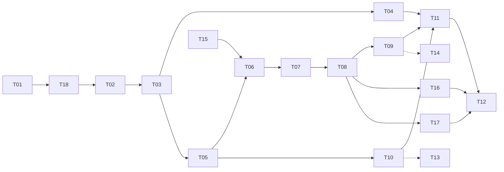

# Octopus 书籍人物 Agent 实施计划

更新日期：2026 年 10 月 15 日。状态：T01 至 T11、T15、T16、T18 已落实；T17 链路已实现、真实回应尚未通过，继续排障后进入 T12。ChatHaruhi 的表达检索、上下文分区和带出处记忆已接入；真实模型仍有误拒、引文歧义及截断案例，完整质量由 T12 判断，表达增强默认关闭。当前按用户要求控制模型调用预算，以固定窗口记录实际用量；Agent 逐项原文复核不冒充人工盲评。

目标是逐步交付自动生成人物 Agent、原著知识约束和多人聊天室。共 16 项首版任务与 2 项增强任务，每项包含可演示的用户行为、真正的前置依赖、实施步骤、验收标准和验证场景。权威约束见[详细设计](F:/god/project/Octopus/docs/plans/book-character-agents/detailed-design.md)，背景见[研究报告](F:/god/project/Octopus/docs/research/2026-10-10-book-character-agents.md)。

## 交付顺序与完成标志

| 阶段 | 任务 | 阶段完成时可以演示的行为 |
| --- | --- | --- |
| M1 人物构建 | T01、T18、T02 至 T04 | 准备整本小说，生成有出处的人物名单与 Agent，纠错后产生修订版本 |
| M2 原著约束单聊 | T05 至 T07 | 看清人物知道什么，与其对话，房间记忆可恢复且不改写原著 |
| M3 多人聊天室 | T08、T09、T16、T17 | 独立 Tab 中圆桌落座、右侧对话及头顶气泡同步；跨书回应、@、禁言移除、全体队列与恢复有效 |
| M4 自动化与首版交付 | T10 至 T12 | 导入触发构建、恢复任务、管理版本与删除，两部书籍的单聊与混聊通过验收 |
| 秒数设置 | T15，已完成设置与持久化 | 用户在设置页保存和回读普通/全体时间上限 |
| 后续增强 | T13、T14 | 更多书籍格式、长书检索与调用预算优化 |

阶段是交付分组，不要求整个阶段串行。T03 完成后 T04、T05 可分别推进；T10 的基础自动导入也可先实现，完整表达任务编排等待 T05。M4 的自动导入不需要等多人聊天室完成。需要并行实施时使用隔离分支并先稳定接口，当前文档工作不创建并行代码任务。

## 任务索引与依赖

| 任务 | 用户可见交付 | 直接依赖 | 阶段 |
| --- | --- | --- | --- |
| [T01](F:/god/project/Octopus/docs/plans/book-character-agents/tasks/01-narrative-source.md) | 在书目中准备可定位的全文来源 | 无 | M1 |
| [T02](F:/god/project/Octopus/docs/plans/book-character-agents/tasks/02-character-discovery.md) | 手动构建全书人物候选名单 | T18 | M1 |
| [T03](F:/god/project/Octopus/docs/plans/book-character-agents/tasks/03-evidence-persona-agents.md) | 生成有原著证据的人物档案与 Agent | T02 | M1 |
| [T04](F:/god/project/Octopus/docs/plans/book-character-agents/tasks/04-evidence-corrections.md) | 纠正人物身份与依据并发布修订版本 | T03 | M1 |
| [T05](F:/god/project/Octopus/docs/plans/book-character-agents/tasks/05-scoped-knowledge.md) | 查询人物知情与经审查的原著表达依据 | T03 | M2 |
| [T06](F:/god/project/Octopus/docs/plans/book-character-agents/tasks/06-bounded-single-chat.md) | 与人物进行受原著约束的单聊 | T05、T15 | M2 |
| [T07](F:/god/project/Octopus/docs/plans/book-character-agents/tasks/07-room-memory.md) | 保留房间记忆并支持独立重置 | T06 | M2 |
| [T08](F:/god/project/Octopus/docs/plans/book-character-agents/tasks/08-multi-character-room.md) | 创建跨书多人房间并进行定向与自然回应 | T07 | M3 |
| [T09](F:/god/project/Octopus/docs/plans/book-character-agents/tasks/09-all-participants-control.md) | 向全体提问并控制可恢复的发言队列 | T08 | M3 |
| [T10](F:/god/project/Octopus/docs/plans/book-character-agents/tasks/10-automatic-import-build.md) | 导入后自动构建人物、表达素材并恢复后台任务 | T05 | M4 |
| [T11](F:/god/project/Octopus/docs/plans/book-character-agents/tasks/11-source-lifecycle.md) | 处理书籍版本更换与删除后的房间状态 | T04、T09、T10 | M4 |
| [T12](F:/god/project/Octopus/docs/plans/book-character-agents/tasks/12-mvp-acceptance.md) | 完成首版回归评测与开关发布 | T11、T16、T17 | M4 |
| [T13](F:/god/project/Octopus/docs/plans/book-character-agents/tasks/13-epub-txt-support.md) | 扩展 EPUB 的导入和人物构建，TXT 移至 T18 | T10 | 增强 |
| [T14](F:/god/project/Octopus/docs/plans/book-character-agents/tasks/14-retrieval-performance.md) | 增强长书检索与控制多人调用成本 | T09 | 增强 |
| [T15](F:/god/project/Octopus/docs/plans/book-character-agents/tasks/15-chat-timeout-settings.md) | 配置人物聊天室时间上限并持久化 | 无 | 设置 |
| [T16](F:/god/project/Octopus/docs/plans/book-character-agents/tasks/16-roundtable-chat-ui.md) | 独立聊天室 Tab、3D 圆桌与同步气泡 | T08 | M3 |
| [T17](F:/god/project/Octopus/docs/plans/book-character-agents/tasks/17-discussion-modes.md) | 主题 / 自由聊天、讨论配置和轮次快照 | T08 | M3 |
| [T18](F:/god/project/Octopus/docs/plans/book-character-agents/tasks/18-txt-library-source.md) | 图书馆 TXT 导入、原文阅读与来源定位 | T01 | M1 |

以下为直接依赖；由依赖链已覆盖的前置任务不重复列出。T13 与 T14 不阻塞首版验收。



T01 至 T11、T15、T16 与 T18 已实施。T17 链路与确定性验证已落实，真实模型回应未通过，下一步继续排障；完整用户路径与模型质量仍等待 T12。

## 已验证阶段与真实语料

T10 已完成迁移 26、小说自动意图、补偿扫描、固定配置三阶段、取消/恢复代数、独立表达及新版本、导入与进度界面。八项新回归、完整项目 199 通过/13 既有环境跳过、42 文件类型检查、Ruff、相关组件 ESLint、构建和实际 REST/WS/浏览器联调通过。三个复核 P2 已关闭；全书真实模型运行仍未通过完整质量，记录失败与用量，见[自动构建验证](validation/2026-10-14-automatic-import-validation.md)。

T09 已完成迁移 25、全体槽位及明确跳过、暂停/继续/停止、有限秒数窗口、首次工作区恢复、过期租约及有效生成占位、增量重连。七项新行为回归、39 文件类型检查、Ruff、相关组件 ESLint、最终构建和实际 WS/浏览器操作通过。两轴复核的一项 P1 和两项 P2 已关闭；实际模型新增调用为 0，受控队列验收不代表人格质量。详见[全体队列记录](validation/2026-10-14-all-queue-validation.md)。

T08 已完成跨书来源/人物绑定、有限自然/定向队列、独立原著取证、公开听说和即时成员控制。13 项新行为回归、39 文件类型检查、Ruff、相关组件 ESLint、构建和实际 WS/浏览器创建与重开通过。两轴复核的两项 P2 已关闭；13 次真实 k3 调用保留自动提取失败、无依据称呼及两次中性称呼复验，不宣称全书人格或整体聊天质量通过。详见[跨书房间验证](validation/2026-10-14-group-room-validation.md)。

T01 与 T18 的来源阶段已通过 51 项设置/来源/上传/Handler 回归、Mypy、Ruff 及浏览器联调。T02 候选发现新增 17 项回归。T03 以新增子构建发布有证据的原著档案与逻辑 Agent，仍未开放聊天室回复。

T03 新增 17 项确定性回归，并完成真实 k3 摘录联调及读者档案/原文浏览器验收：1 ready、3 sparse、2 群体待复核，部分发布明确显示拒绝项和不确定基线。全书模型质量仍留在 T12，具体结果见[原著档案验证](F:/god/project/Octopus/docs/plans/book-character-agents/validation/2026-10-12-persona-validation.md)。

T04 新增 14 项公共服务与 Handler 回归，完整项目 108 通过、13 既有环境跳过。迁移 17 落实修订头、审计和读者扩展；原文审查、同来源子构建、重新提取、独立归属完成检查、编辑/发布 CAS、旧版回溯和纠错界面均已接通。真实 k3 以单任务 8192 token 预算完成 6 次调用，纠正对象 sparse、2 单元通过，全局模型设置未变；早期 4096 截断探针暴露的身份发布问题已增加失败保护。范围与限制见[纠错验证记录](F:/god/project/Octopus/docs/plans/book-character-agents/validation/2026-10-12-revision-validation.md)。

T05 已完成：迁移 18–21、CanonicalScope/AllowlistedContext、安全基线与历史回顾、表达独立构建及审查、桌面协议与人物预览已接通。新增 16 项行为回归，完整项目 124 通过、13 既有环境跳过；Mypy 22 文件、Ruff、ESLint 与前端构建通过。真实 k3 两个人物摘录路径共 4 次调用，尚无可用对白，保留空素材和部分完成状态；不能据此宣称聊天质量提升。范围与后续验证见[知识/表达验证记录](F:/god/project/Octopus/docs/plans/book-character-agents/validation/2026-10-12-knowledge-expression-validation.md)。

T06 已完成：迁移 22/23、作用域上下文、有限生成/独立审查/改写、原子发布、计时与停止/继续、桌面协议及单聊入口已贯通。新增 30 项回归，完整项目 154 通过、13 环境跳过；模块 Mypy 33 文件、Ruff、ESLint 与生产构建通过。真实界面探针 10 次调用，有效表达对照累计 18 次调用；B 实际使用本人对白，但未证明质量改善，增强仍默认关闭。六项 UI 竞态、重开计时与当前 WS 历史/取证验收通过；原预算恢复、幂等和情绪类型问题完成复核。见[单聊阶段验收](F:/god/project/Octopus/docs/plans/book-character-agents/validation/2026-10-12-single-chat-validation.md)。

T07 已完成来源摘要、作用域召回、房间状态与重置的完整链路。迁移 24、17 项新记忆测试及旧轮恢复参数回归，模块 Mypy 35 文件、Ruff、ESLint、构建和实际组件/WS 验收通过；完整项目最终计数见[阶段验收](F:/god/project/Octopus/docs/plans/book-character-agents/validation/2026-10-13-room-memory-validation.md)。四个复核 P2 均以失败回归修复。真实 k3 七次固定预算取得正确摘要，但人物候选来源分类不合契约，未知回退误拒可回答代号；保留为 T12 案例，不宣称真实回忆问答质量通过。跨书成员采用临时 SQLite 契约夹具验证，群聊创建和真实互动等待 T08/T12。

T02 两部完整语料的工作器遍历使用不生成任何人物断言的替身，覆盖 322 / 275 个检查点；真实 k3 仅做原著摘录联调。样本四个个体候选及两个待复核群体不代表全书召回或人格质量。具体限制、模型适配与证据见[人物发现验证记录](F:/god/project/Octopus/docs/plans/book-character-agents/validation/2026-10-12-discovery-validation.md)。

按用户指定语料仓库固定提交，选取完整《西游记》《红楼梦》，验证全部 3311 / 2665 个片段及原文尾部。当前在隔离验收工作区，书籍完整性和模型质量分别报告。详细证据见[验证说明](F:/god/project/Octopus/docs/plans/book-character-agents/validation/2026-10-12-source-validation.md)与[语料记录](F:/god/project/Octopus/docs/plans/book-character-agents/validation/corpus-sources.json)。

## 每项任务的执行方式

1. 读取详细设计、对应任务与其前置任务的完成记录，确认公共接口已存在。
2. 用最小完整样本定义行为测试，在临时工作区验证数据库、服务端和模型输入边界。
3. 完成这条用户行为涉及的存储、服务、协议与界面；每次迁移为新增步骤，不改已执行迁移。
4. 跑与改动相符的测试和前端构建，演示任务交付，记录限制。
5. 将该任务的代码、必要测试和文档作为可独立审查的提交；前置未完成或验收未通过时不宣称 ready。

不用一次把全部数据表、全部 UI 或所有 Agent 配置写完再串联。T01 仅建立来源所需表，T02 增加候选与构建表，T03 增加原著知识表，T06 才增加房间基础表，后续阶段按实际行为扩展。

## 建议的代码接入图

已完成任务的接入已存在，后续任务的路径仍为实施建议。实际路径若调整，必须保持接口和测试边界；逐任务正文不绑定内部文件路径。

拟新增的服务包为 backend/services/book_world，公开入口集中在 __init__.py；将来源解析、构建、原著查询和房间调度分成小模块。存储可按 build_store、canon_store 和 room_store 分开，避免单个仓储文件过大。模型适配不复用 LibraryChatAgent 的通用工具映射。

| 任务 | 新增职责或接口 | 现有接入点 |
| --- | --- | --- |
| T01 | source、来源与片段存储、来源准备 Handler、原文定位面板 | [library_engine.py](F:/god/project/Octopus/backend/services/library_engine.py:1432)、[knowledge_migrations.py](F:/god/project/Octopus/backend/services/knowledge_migrations.py:627)、[LibraryItemDetail.jsx](F:/god/project/Octopus/frontend/src/pages/Knowledge/library/LibraryItemDetail.jsx:28) |
| T02 | build、worker、extraction、构建与人物候选存储、人物列表 | [registry.py](F:/god/project/Octopus/backend/channels/desktop/handlers/registry.py:210)、[protocol.py](F:/god/project/Octopus/backend/channels/desktop/protocol.py:78)、[schemas.py](F:/god/project/Octopus/backend/channels/desktop/schemas.py:8) |
| T03 | canon_store、构建证据校验、人物基线与运行策略、详情与引用 | [LLMProvider](F:/god/project/Octopus/backend/core/providers/base.py:45)、[LibraryTab.jsx](F:/god/project/Octopus/frontend/src/pages/Knowledge/library/LibraryTab.jsx:22) |
| T04 | evidence_bound_revision、候选合并与修订发布、纠错界面 | 新人物详情与构建接口 |
| T05 | knowledge、AllowlistedContext、CharacterExpressionService、ExpressionContext、中文词项/表达索引与双通道预览 | [现有片段检索](F:/god/project/Octopus/backend/services/library_engine.py:1530) 作为对照，不直接复用其全局查询 |
| T06 | rooms/rounds、context、chat_worker/chat_validation/chat_provider、book_room Handler、单聊面板和预算诊断 | [provider factory 的调用方式](F:/god/project/Octopus/backend/agent/library_chat_agent.py:366)、[LibraryChatDrawer.jsx](F:/god/project/Octopus/frontend/src/pages/Knowledge/library/LibraryChatDrawer.jsx:1) 的展示样式 |
| T07 | typed_room_summary、房间重置与 epoch、新人物聊天 Hook | [useChat.js](F:/god/project/Octopus/frontend/src/pages/Knowledge/hooks/useChat.js:1) 的传输模式，独立实现多人状态 |
| T08 | coordinator、成员管理、directed/natural 策略、人物消息列表 | 新 book_room Handler 与单聊房间服务 |
| T09 | 持久队列、租约与 cursor、停止继续、断线补拉 | [WebSocket Handler 基类](F:/god/project/Octopus/backend/channels/desktop/handlers/base.py:14)、[DesktopChannel](F:/god/project/Octopus/backend/channels/desktop/channel.py:267) |
| T10 | 自动构建意图、来源就绪检查、启动补偿、构建恢复 | [library_create](F:/god/project/Octopus/backend/channels/desktop/handlers/library.py:112)、[LibraryImportModal.jsx](F:/god/project/Octopus/frontend/src/pages/Knowledge/library/LibraryImportModal.jsx:41) |
| T11 | 来源失效、版本快照、缓存与工作器生命周期、只读房间 | [删除书目](F:/god/project/Octopus/backend/services/library_engine.py:510)、[服务 lifespan](F:/god/project/Octopus/backend/api/server.py:29) |
| T12 | 验收入口、特性开关、评测记录、迁移与回滚说明 | [pyproject.toml](F:/god/project/Octopus/pyproject.toml:11)、[frontend/package.json](F:/god/project/Octopus/frontend/package.json:6) |
| T13 | EPUB 解析、附件与原文阅读分支；TXT 已提前交付 T18 | [library_upload.py](F:/god/project/Octopus/backend/api/routes/library_upload.py:16)、现有附件管理 |
| T14 | 允许集语义检索、固定依据缓存、usage 与预算控制 | 新 knowledge、worker 和 coordinator 接口 |
| T16 | book-rooms 页面、useBookRoom、BookRoomScene/Canvas、头顶 DOM 气泡与座位分配 | [App.jsx](F:/god/project/Octopus/frontend/src/App.jsx)、[LibrarySceneCanvas.jsx](F:/god/project/Octopus/frontend/src/pages/Knowledge/library/scene/LibrarySceneCanvas.jsx)、现有 Babylon.js 依赖 |
| T17 | set_discussion、讨论 revision、轮次快照、主题上下文与模式控件 | 新 room_store、coordinator、book_room Handler 和房间页面 |

人物用专用 book_world / book_room 协议，不把多人消息塞入原 library_chat 的单 Agent 配置字段。无需重构旧知识库图谱，也不将工作流 KnowledgeService 占位接口作为依赖。

## 先固定的接口与行为

为了让人物纠错、受限查询和自动导入可以独立推进，T03 完成时必须固定：

- PublishedBuild：来源与配置版本、完整或部分发布状态、有效人物名单。
- CharacterIdentity：book_id、source_version_id、build_id、character_id、lineage_id、Agent 状态与固定基线。
- CanonicalClaim：断言类型、所属人物、有效状态、依据与修正关系。
- CharacterAccess：获知路径及证据，不接受客户端或模型直接声明权限。
- SourceLocator：book_id、来源版本、片段与规范化偏移；PDF 页内定位单独记录。

T06 完成时固定 RoomSnapshot、RoomSourceBinding、MemberScope、RoundSnapshot、发布消息身份与序号、client_turn_id、epoch 与 membership_generation。后续多人任务扩展成员与队列，不重写已存在的单聊语义。

人物与聊天室新表位于工作区知识数据库；全局 app.db 保存模型及时间默认偏好，工作区保存运行快照。异步调用不持有数据库事务，工作器使用显式根路径和独立连接，不共享 LibraryEngine 的连接对象执行跨线程写入。

## 跨书群聊与成员控制

首版允许同一工作区内多书混聊。房间不再绑定一个全局 B；每个成员绑定各自的 room_source 和人物，原著检索及消息原著引用按该成员 B 校验，公共历史按 R 共享。每房每书固定一个构建；同书多个译本或构建对比暂不混入同一房间。

成员有 auto、mention_only、muted 三种发言模式。mute 后仍在场但不能回应，包括 @；remove 将 active 置零，仅影响本房间。控制操作可以在运行中发生，必须递增 membership_generation 并撤销该成员未发布的槽位；解禁或重新加入不能恢复旧授权。新来源与新成员仅在轮次空闲时加入。

自然模式默认至多三人，单独 @ 使用 member_id，@全体明确记录禁言或来源失效的跳过原因。公开消息不是自动唤醒全员的触发器，本轮结束等待用户。来源删除只禁用该书成员，保留其他来源的队列和回复；没有可用来源才使房间只读。

T06 建立通用来源绑定；T08 实现跨书选择、同名 @ 和成员控制；T09 实现混合队列与控制竞争；T11 验证部分来源删除；T12 同时验收同书和跨书边界。

## Agent 复核与两种讨论方式

理论映射见[复核报告](F:/god/project/Octopus/docs/plans/book-character-agents/agent-design-review.md)。T03 在已有断言与基线结构中加入有据的动机/价值槽位，证据不足保持 unknown；T06 明确对话行为和情绪触发消息的校验。论文提供设计参考，不构成当前模型零越界或完整认知模拟的证明。

T17 在 T08 基础上实现 free/topic，与 natural/directed/all 发言方式独立。先落实房间配置、revision 和旧库 free 默认；再固定服务端轮次快照与主题上下文；最后接入界面和六种模式联调。T09 的全体/恢复及 T16 的圆桌集成在 T12 验收，T12 增加 T17 为直接依赖。

同一房间可以换模式和主题，保留成员、座位和当前 epoch 的公共记忆；活跃或暂停轮次尚未结束时禁止修改。继续旧轮沿用原讨论快照，新轮读取当前配置；两个讨论方式均使用既有秒数、禁言及有限队列规则，不自动续轮。

## ChatHaruhi 方法落地与质量门槛

按[适配设计](F:/god/project/Octopus/docs/plans/book-character-agents/chatharuhi-adoption-design.md)采用原著表达检索、上下文分区与同模型对照。主线使用当前模型、存储和发布接口；原项目只作为方法及可选实验参考。表达样例必须有本人发言证据、完整 B、有效安全投影与当前基线相容检查，不能借用其他人物或外部角色包。

| 子交付 | 所属任务 | 完成时可验证的行为 |
| --- | --- | --- |
| Q01 允许事实与表达索引 | T05 | 权限前置；表达派生状态独立；规则/对白、原文定位和缺素材结果可预览 |
| Q02 相关样例与预算组装 | T06 | 按行为/主题选择至多 2 条短样例，保留当前问题、约束和事实；候选校验仍覆盖全部断言 |
| Q03 记忆分区与长对话 | T07 | 本房间听说、原著素材及固定人设保持独立；重置后旧历史排除 |
| Q04 导入、恢复与清理 | T10、T11 | 新原著发布后排表达任务；取消/预算失败保留可用人物；源失效只清理对应书的素材 |
| Q05 真实质量对照 | T12 | 原 60 项＋24 项表达样本，同模型 A/B，逐人物报告正确性、误拒、表现和成本 |

Q01–Q05 为既有任务内子交付，不另设跳过原任务依赖的路径。初始表达上限为 2 个对白、各 160 码点及 3 条已有表达规则，T12 调优；语义/向量增强仍在 T14。Q01 的原生服务/预览、Q02 的运行时接入/小对照、Q03 的记忆分区与长对话预算已完成；Q04–Q05 继续按依赖实施。记忆摘要正确不等于回复正确，质量收益须由实测证明。未安装第三方运行库或导入外部角色包。

## 圆桌界面实施

新入口为与林间图书馆并列的“人物聊天室”Tab，采用左侧 3D 圆桌、右侧完整消息和输入栏。具体布局、状态、座位与气泡投影规则见[圆桌交互设计](F:/god/project/Octopus/docs/plans/book-character-agents/roundtable-ui-design.md)。

T16 拆为三次可演示交付：先实现路由、房间选择、持久座位和圆桌落座；再接入真实已发布消息与头顶同步气泡；最后完成 @、禁言移除、恢复、窄屏与 WebGL 降级。可以先用固定快照制作场景样稿，但必须完成 T08 服务联调才能标记任务完成。T09 的全体队列和续时控制接入同一右栏，T12 等待 T11 和 T16。

服务端保管 member_id 与 seat_index，房间保存布局版本和容量。移除保留空椅，重返/重置不改座位；人数增加只在空闲时扩容，不将 8 座展示默认值当作成员上限。迁移给既有成员一次性回填稳定座位，并建立房间内唯一约束。

useBookRoom 统一接收快照和去重消息，场景仅拿公开投影。生成时先显示状态气泡，message_published 后右栏与气泡使用同 message_id/seq 同步显示校验正文；逐字效果仅为展示动画。迟到进度不驱动正文，重连补拉不批量重播历史气泡。

复用林间图书馆的 Babylon.js 依赖、木桌椅及材质风格，renderer 独立管理 GPU，不承担模型和房间业务。生产构建与操作验收覆盖 1/4/8/16/32 人、资源释放、遮挡、长中文、控制竞争和原有林间图书馆回归。该 Tab、场景与真实服务联调已完成，详见[圆桌验收](validation/2026-10-14-roundtable-validation.md)。

## 时间设置实施

T15 的设置界面、保存回读、恢复默认、输入校验和旧库兼容已实现。实际计时、超时暂停及继续的最新值读取仍由 T06/T09 接入，偏好保存测试不代表运行时计时完成。

T15：在既有“设置 → 图书馆”中增加普通轮次和全体提问上限，分别默认 60 秒与 300 秒，接受自定义正整数秒。两项保存在全局 agent_defaults，扩展现有读取、更新和前端映射，旧请求保留原值。迁移草案见[timeout-settings.sql](F:/god/project/Octopus/docs/plans/book-character-agents/timeout-settings.sql)。

T15 已交付设置保存、刷新回读、恢复默认和非法值拒绝。T06 读取并快照所选模式上限，单聊即有基本时间限制；T09 完成暂停续时、剩余队列和计时竞争。T12 验收用户真实设置与两种模式的端到端应用。

时间是每次执行窗口上限，不是保证回复速度。计时包括检索、生成与校验，暂停或中断不耗用窗口；超时拒绝迟到发布。手动继续读取最新配置，重置本窗口用时并保留累计用时，不能自动续时。

全局设置迁移与工作区轮次字段迁移分别执行，不对真实库直接运行设计 SQL。全局设置没有跨库外键，运行快照只含非敏感整数与审计用时，不改变人物及原著数据。

## 存储落实与迁移分批

以[详细设计](F:/god/project/Octopus/docs/plans/book-character-agents/detailed-design.md)的存储维度和[SQL 结构草案](F:/god/project/Octopus/docs/plans/book-character-agents/storage-schema.sql)为统一契约。附件包含 25 张核心业务表与 FTS5；T04 补充修订表已单独落地，T05 表达派生表由[适配设计](F:/god/project/Octopus/docs/plans/book-character-agents/chatharuhi-adoption-design.md)定义并随新迁移实现。复合父键、子外键、作用域必填、对应索引与保护触发器在同一批迁移中加入，避免先靠应用约定、最后再补隔离。

| 首次落地任务 | 表与约束 | 隔离验收 |
| --- | --- | --- |
| T01 | book_books、book_source_versions、book_segments；来源唯一组合、片段 ordinal、来源不可变与最小删除禁用 | 同一书籍的不同附件或解析版本不混用；原文尾部和短对白保留 |
| T02 | book_builds、book_build_steps、book_scenes、book_scene_segments、book_characters、book_character_aliases、book_scene_characters | 场景片段与人物绑定同书同来源同构建；同名别名允许歧义 |
| T03 | book_claims、book_evidence、book_claim_access、book_access_evidence、book_character_baselines；原文位置、私有人格所有权、发布冻结 | 不能授权他人人格项；可见引文属于该人物与该断言；基线只能引用本人权限 |
| T04 | 修订构建及父版本复合外键；book_revision_heads、book_revisions、book_user_extensions，迁移 17 | 同来源父版、请求幂等、编辑与发布 CAS；读者扩展不进入 Agent；旧构建保持不变 |
| T05 | book_claims_fts 与同步触发器；CanonicalScope；book_expression_sets/materials/refs 及表达索引 | 允许集和安全投影先于排序/LIMIT；素材不新增知识授权；缺证据、降级和缓存不扩大范围 |
| T15 | app.db 的 agent_defaults 新增两项正整数秒字段；设置加载、保存、校验与默认值 | 刷新和重启仍可回读，非法输入不修改已有偏好 |
| T06 | book_rooms、book_room_sources、book_room_epochs、book_room_members、book_room_rounds、book_round_slots、book_room_messages、book_message_refs | 单聊也建立来源绑定和槽位；成员以自己的 B 匹配来源绑定与人物，消息及引用匹配发言者，另记录时间快照与当前窗口用时 |
| T07 | book_room_summaries、book_summary_sources；重置事务与 state_epoch | 摘要与听说只引用同 room_id＋epoch；旧代数保留时也不可读入当前上下文 |
| T08、T09 | 扩展 T06 已有多来源绑定、成员与槽位；增加即时成员控制，不另建跨书记忆数据库 | 同房间一活跃轮次；时间上限快照、超时暂停、手动新窗口；过期租约或成员授权不能发布 |
| T10 | 在现有来源/构建和独立表达集增加自动流程及恢复行为 | 工作区、来源和配置指纹固定；补偿幂等；表达失败不撤销已可用原著 |
| T11 | 生命周期禁用、原著/表达载荷清理和身份元数据保留 | 来源绑定 B 与人物身份保留；只停用该书成员，最后一个可用来源删除后房间才只读 |
| T16 | rooms 的 scene_layout_version/scene_capacity、members 的 seat_index；唯一座位、不可改绑与空闲扩容 | 座位只控制展示；移除/重置不改变原著范围和成员身份 |
| T17 | 复用迁移 22/23 的讨论字段与冻结快照；迁移 28 增加 book_room_summary_jobs，已审查正文仍进入迁移 24 的房间记忆 | 主题不扩大允许集；换题不改 R；暂停恢复不改原主题 |
| T12 | 汇总迁移、索引与隔离回归 | SQL 结构检查与真实模块、真实模型验收分开报告 |
| T13、T14 | 复用同一来源与作用域，增加格式解析或检索能力 | 新格式、向量、预算与缓存不得绕过既有复合范围 |

B 为 book_id＋source_version_id＋build_id，R 为 room_id＋epoch。book_id 是人物模块的稳定身份，library_item_id 仅映射现有书目；lineage_id、标题、文件路径和模型生成 ID 不承担权限判断。

所有存储入口接收服务端构造的 CanonicalScope 或 RoomScope，工作区选择固定在数据库连接与缓存身份上。原著关联用完整 B 与 character_id，消息和摘要用完整 R；无范围的单 ID 快捷接口不暴露给人物运行时。每个连接在事务前启用 foreign_keys；SQLite 的关联约束不代替 SELECT 的范围条件。新增迁移与校验连接也必须启用外键；复用现有 MigrationRunner 时在 T01 补齐这一连接设置并回归旧迁移。

T06 的单聊已需要 epoch、轮次、槽位、租约与规范化消息引用；T09 是多人队列控制的扩展，不推迟这些基础约束。rooms 与 epochs 的循环外键在同一迁移中创建，房间初始写入使用单事务及延期外键。

重置时取消轮次、增加租约代数、新建 epoch、切换 current_epoch 并清空成员短暂状态，消息 next_seq 不归零。来源删除保留书籍、版本、构建、人物和 room_source 身份，清理原著载荷与版本文件；只停用受影响成员。有其他可用来源的混聊继续，全部来源失效后只读。

## 存储草案检查记录

已运行[结构校验脚本](F:/god/project/Octopus/docs/plans/book-character-agents/storage-schema-check.py)，在 SQLite 3.45.3 的内存库完成 177 项检查。主题/自由修订新增 36 项，覆盖配置、版本、模式组合、快照冻结、暂停恢复和换题保留记忆；原有座位、跨书、成员控制、时间窗口与隔离检查继续通过。最终 foreign_key_check 无错误。

该脚本只连接 :memory:，使用简化的既有书目父表，不接触真实工作区数据库。它验证 SQL 结构和触发器，不代表应用模块、文件清理、工作区切换或真实模型语义已通过验收。

```powershell
python docs/plans/book-character-agents/storage-schema-check.py
```

## 测试夹具与质量样本

从 T01 起提供一个原创短篇的固定样本，含四个可区分人物、多种称呼、短对白、旁白秘密、甲的错误信念与后续修正。另提供超过 100 个片段的长版本，把关键人物或获知事件放在尾部。测试样本不依赖用户立即提供真实书籍。

从 T02 起使用可记录调用输入的 FakeProvider，按阶段返回候选结构。它用来验证服务发送了什么、拒绝了什么、是否发生重复调用；不证明真实模型的人格或事实表现。

T12 使用用户选定的两部完整书籍与实际模型，保留 60 个经人工复核的评测项：12 个可知事实、12 个不可知事实、8 个信念与修正、8 个观念情感场景、8 个房间记忆和 12 个多轮或多人边界场景。另新增 24 个表达/交流质量问题，回答、质疑、安慰、分歧、未知表达和跨书听说各 4 项；先以其中 8 项做小预算 A/B，再完整评测。共 84 个问题，策略对照会产生多份回答，实际调用预算另行明确；当前不是已获得的样本或效果结论。

评测记录包含书籍与来源哈希、人物构建、模型与策略版本、问题、预期知情与依据、实际答复、判定和调用量。LLM Judge 可辅助分组，关键边界失败由读过原书的人复核。

## 拟新增测试与检查命令

建议测试文件按行为分为 test_book_storage_schema、test_book_source、test_book_build、test_book_persona、test_book_knowledge_scope、test_book_character_runtime、test_book_room_memory、test_book_room_coordinator 与 test_book_world_lifecycle。必要时继续拆小文件，不将全部测试塞入一个集成用例。

下面是代码实施阶段拟新增功能测试的命令；与上方已经执行的 SQL 草案校验分开记录：

```powershell
python -m pytest tests/test_book_storage_schema.py tests/test_book_source.py tests/test_book_build.py -q
python -m pytest tests/test_book_persona.py tests/test_book_knowledge_scope.py tests/test_book_character_runtime.py -q
python -m pytest tests/test_book_room_memory.py tests/test_book_room_coordinator.py tests/test_book_world_lifecycle.py -q
python -m ruff check backend/services/book_world backend/channels/desktop/handlers/book_world.py backend/channels/desktop/handlers/book_room.py
npm run build --prefix frontend
```

测试路径属于拟新增文件，实施后再执行。命令在 F:/god/project/Octopus 工作目录运行；环境缺少测试依赖时先按项目依赖配置补齐。前端当前没有 test 脚本，不预设 npm test 可用。

每项任务运行相关用例，首版集成时再运行完整项目测试并记录既有失败或环境跳过，不能用跳过结果当作功能通过。界面需操作验收：导入、人物名单、依据定位、独立聊天室 Tab、圆桌落座与气泡同步、单聊、多人点名、全体队列、停止、重置、重连和来源删除；覆盖二维降级与林间图书馆回归。

## 可配置的首版运行边界

| 项目 | 首版设计值 |
| --- | --- |
| 构建并发 | 一项构建，先控制资源占用 |
| 自然模式发言人数 | 默认至多三人 |
| 全体模式 | 全体有效成员快照，每人一槽位，没有少数人物的隐式截断 |
| 自动互动轮数 | 每次提交一轮，不自动续轮 |
| 讨论方式 | 默认自由聊天 free；可设置主题聊天 topic，均可自动选人、@ 人物或全体 |
| 候选格式或回复修复 | 最多重试或重写一次，仍失败进入明确失败或未知回复 |
| 人物正文发布 | 经校验后发布，原始 token 内部缓冲；右栏与气泡同消息同步 |
| 圆桌默认容量 | 8 座，可在空闲时扩展；不限制成员和全体队列 |
| 新房间与重置 | 固定原著基线，房间 epoch 独立 |
| 原著检索降级 | 只在允许集合内进行 |
| 普通轮次时间上限 | 默认 60 秒，设置中正整数秒自定义 |
| 全体提问时间上限 | 默认 300 秒，设置中正整数秒自定义 |
| 时间配置生效 | 新轮次或手动继续时保存快照，运行中不改变 |
| 超时行为 | 暂停，保留已发布与剩余队列；继续启动新的有限窗口 |
| 模型和总预算 | 由当前配置与实际 context/usage 决定；超限暂停或明确报错，不丢队列 |

普通/全体执行窗口使用上述秒数默认值及用户配置。模型上下文、生成长度、单次调用超时和租约过期值由实现阶段根据所选模型能力配置；必须显式设置，不能沿用不适合该任务的 provider 默认上限。lease 心跳与过期时间的关系通过竞争测试验证。时间配置使用严格秒数，避免将毫秒误当秒或允许 0 关闭上限。

## 首版验收与回滚

首版完成的判定包含完整用户路径和四项确定性约束：无跨人物或跨工作区取证、无过期结果发布、无重复槽位发言、无聊天回写原著。真实模型表现单独报告可知事实正确率、不可知事实拒绝率、无依据断言、人物表现与多人关联性。

启用顺序为人物名单 → 受限单聊 → 多人房间 → 导入自动构建。开启自动构建前必须通过任务恢复与配置不可用场景。关闭功能开关应停止接收新任务并取消或暂停现有工作，保留已有数据。

迁移采用新增方式并备份工作区数据库；回滚通过关闭入口与工作器实现，保留新增表。首版不要求移除旧 library_chat 或重建已有知识库。

## 当前交付状态

时间配置已落实到现有设置页与后端持久化。验证：20 项实际后端测试通过，Ruff 检查通过，前端生产构建通过。测试使用 .gitignore 的精确例外纳入版本控制范围。T06 与 T09 已落实单聊/全体计时、超时暂停及窗口恢复。

已交付详细设计、实施计划、18 份本地任务、领域词汇、SQL 草案及内存校验脚本，并落实 T01 至 T11、T15、T16、T18。来源为工作区迁移 14，候选为 15，原著断言/权限/基线与冻结为 16，修订与读者扩展为 17、知识/表达为 18–21、房间为 22/23、来源记忆为 24、全体队列为 25、自动构建为 26、生命周期清理为 27；完整 SQL 附件仍为核心设计契约。T11 的旧版本固定、局部删除交接、清理失败重试、工作区检查与关闭排空通过，详见[生命周期验收](validation/2026-10-14-source-lifecycle-validation.md)。T16 圆桌、聊天室 Tab 和气泡已完成；T17 讨论配置、上下文和后台总结链路已实现，真实模型探针已有成功发布，但仍有无据经历/情节的语义漏检，任务未关闭。两部全书自动构建当前均在 discovery 阶段失败，快照保留失败，不能据摘录或受控场景宣称全书人格质量通过。

本功能 docs 已纳入版本控制；tests/ 仍按精确文件例外跟踪新增回归。首版书籍已确定为用户语料仓库的《西游记》《红楼梦》，正文保留在忽略的验收工作区；提交来源哈希、验证记录及截图。真实模型质量基线仍在 T12 人工验收中补齐。

## 精度与聊天质量验收契约

ChatHaruhi 的方法适配继续沿用 Q01–Q05；新增[质量验证协议](F:/god/project/Octopus/docs/plans/book-character-agents/chat-quality-protocol.md)作为实际执行标准，不增加首版任务或改写已完成任务状态。

- T06：完整正文/否定自传的反例与正例，新策略真实复验，以及有素材实际进入上下文的两组有据/无据小对照；记录预算、调用、失败和模型/人工分歧。
- T07：原著、房间听说和当前交流来源分别保留，验证长对话中来源不丢失、重置后不串记忆。
- T08/T09/T17：在既有六种组合中检查回应衔接与人物立场，同时验证 @、禁言、移除、有限队列和秒数窗口；公开发言不自动续轮。
- T10/T11：构建/素材策略变化产生新版本，自动派生和失效清理保留来源，不用外部人物包补原著授权。
- T12：60 项边界与 24 项表达题分别报告提取、检索、正文正确性、人物/交流质量及成本；实际有效 A/B、人工盲评和关键失败复核通过后决定增强默认开关。

当前 T05/T06 服务与阶段验证已完成。早期无依据否定经历及空对白对照保留为诊断；新策略和有效输入对照已复验，但仍不能以引用存在、模型复核通过或小样本宣布完整质量收益。

T17 最新进度与原始失败见[讨论验证](validation/2026-10-14-discussion-validation.md)。公共总结启动立即返回任务身份，最多两次模型调用；停止、重置、最后来源删除或重启撤销任务代数，发布正文与 completed 状态同事务。旧客户端未传讨论版本时使用当前配置，新客户端传期望版本。未通过的真实回应不据受控测试关闭。

模型契约加固与最新真实失败见[2026-10-14 模型验证](validation/2026-10-14-model-contract-validation.md)：发现按当前字面名字建输入、有限定点修复与身份拆分，失败检查点同事务检查删除授权；聊天增加明确ordinal、审查预算裁剪、完整正文和否定经历检查。两部v10全书窗口仍失败，T17合理回应/听说边界及T12质量保持未验收。

发现v11已修复零结束偏移无法进入唯一引文定位的问题；真实旧响应14个引文经生产校验精确定位，旧失败构建未改写。60项发现/模型契约与39项共用证据回归通过，详见[零偏移验证](validation/2026-10-14-zero-offset-validation.md)。新全书窗口仍须独立记录，不据重放宣布全书质量通过。

v11完整来源窗口已结束：预算24、实际9次，两部发现仍失败；西游记2/411单元、13/3311片段，红楼梦2/581单元、10/2665片段，不与旧构建进度相加。具体失败与下一步见[零偏移验证](validation/2026-10-14-zero-offset-validation.md)。

发现v12新增有范围和输入预算限制的原文编号修复，组装后仍经完整旧校验；两份真实失败单元的固定修复探针通过，但不代表全书质量。全部book回归271项通过，Mypy49文件通过。用户暂停时全来源窗口已启动13次，西游记完成9/411单元、87/3311片段，红楼梦尚未执行；已撤销隔离任务继续执行权限并停止探针，检查点保留。详见[编号修复验证与暂停快照](validation/2026-10-14-source-choice-validation.md)，T17/T12保持未验收。

已按当前用户指令恢复推进：v12-02 已执行固定24次窗口，续用原构建检查点。西游记完成16/411单元、132/3311片段后在单元16失败；红楼梦完成7/581单元、55/2665片段后预算中断，终止确认后服务恢复撤销子租约，检查点保留；不与旧构建进度相加。聊天最新v12/v8取得两道开发题有限安全发布，旧v11否定经历失败保留，转述语境与旧策略门控复核问题已修复。最终完整项目304通过/13既有环境跳过，Mypy49文件、Ruff、前端类型与构建通过。阶段证据和下一步见[细节/否定复验](validation/2026-10-14-detail-grounding-validation.md)，T17/T12仍未关闭；先解决多层发现修复，再继续全书与完整首版验收。

v12 修复器已补齐明确不确定身份冲突与字面错误的同次修复，不能保持旧ID或成为ready Agent；两个固定真实失败输入组装后通过，未发布或计全书质量。完整项目313通过/13既有环境跳过，追加三例另跑通过。v12-03使用补丁加载前的解码器，预算16/实际5，红楼梦推进至10/581单元、65/2665片段后超时及场景外别名证据失败；西游记仍16/411。记录见[身份冲突修复验证](validation/2026-10-14-binding-repair-validation.md)，接下来显式重试已诊断失败，并用当前代码记录有限全来源服务窗口；T17/T12保持未验收。

T12 已提前推进不依赖全书完成的发布开关子交付：进程冻结四项能力、入口/扫描门控、旧租约恢复、当前服务能力确认及只读历史/安全撤销已接通，不删除任何记录。最终完整项目329通过/13既有环境跳过，Mypy50文件、Ruff、前端类型/构建通过；开关关闭的实际历史/停止/原文组件验收通过。完整发布清单和模型质量未关闭，见[阶段验证](validation/2026-10-14-release-gates-validation.md)。v12-04预算24/实际12，西游记17/411单元、143/3311片段，红楼梦13/581单元、82/2665片段；两部仍失败，继续诊断而不放宽授权或宣称完整人格。

v13首次编号发现/服务器引用/全单元身份注册已接通原存储、有限修复和授权栅栏，旧策略保留；必要容量及匿名精确引用经过复核补齐。最终完整项目352通过/13既有环境跳过，恢复时编号/修复68项及51文件限定范围类型检查通过。两个固定原生变体及全来源窗口失败保留，v13-01实际22次，西游记10/411、红楼梦2/581，不与v12数据相加。无调用重放确认剩余失败仍涉及场景内新称呼与结构字段，继续有限修复。见[编号阶段记录](validation/2026-10-15-numbered-discovery-validation.md)，T17/T12均未验收。

v14在字面选项不足时保留合法条目，只用本场景固定原文窗口有限修复失败目标；旧v13不改，缺省既有名字仅唯一字面可还原，uncertain仍待复核。两份冻结失败原生修复通过，最终完整项目369通过/13既有环境跳过，专项85项、限定Mypy52文件、Ruff、前端类型/构建与真实失败/原文组件操作通过。v14-01预算32/实际9，两部独立构建仍失败（西游记1/411、红楼梦3/581）；不与旧进度相加。见[窗口修复验证](validation/2026-10-15-window-repair-validation.md)。继续结构诊断、有限恢复和全书/聊天验收，T17/T12保持进行中。

已补具体场景/人物编号错误反馈，七项追加回归及发现相关92项通过，不改原拒绝条件。v14-02总上限32、每书16、实际31次，沿用同一v14检查点：西游记12/411单元、107/3311片段后按预算撤销租约并保留队列；红楼梦10/581、65/2665后因字段归属结构错误失败。详见[诊断与恢复](validation/2026-10-15-discovery-feedback-validation.md)。没有完整原著档案发布，继续审计新失败；T17六组合的独立有界评测正在准备/执行，不能据此关闭T12。
