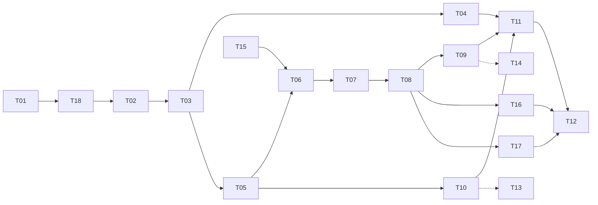

# Octopus 书籍人物 Agent 实施计划

更新日期：2026 年 10 月 16 日。状态：T01 至 T12、T15、T16、T17、T18 已落实链路与确定性层；T12 8-pilot + 60+24 + A/B 三档真实模型层已跑完（盲评工具就绪，待人工执行 160 case 判定）；T17 cognition 第 3 题 + rephrase_claim 操作超出本次范围。ChatHaruhi 的表达检索、上下文分区和带出处记忆已接入；真实模型仍有误拒与完成式过强案例，runner 不声称质量层通过（`quality_pass=False` / `semantic_review=pending`），质量由人工盲评把守。当前按用户要求控制模型调用预算，以固定窗口记录实际用量；Agent 逐项原文复核不冒充人工盲评。

目标是逐步交付自动生成人物 Agent、原著知识约束和多人聊天室。共 16 项首版任务与 2 项增强任务，每项包含可演示的用户行为、真正的前置依赖、实施步骤、验收标准和验证场景。权威约束见[详细设计](F:/god/project/Octopus/docs/plans/book-character-agents/detailed-design.md)，背景见[研究报告](F:/god/project/Octopus/docs/research/2026-10-10-book-character-agents.md)。

## 交付顺序与完成标志

| 阶段 | 任务 | 阶段完成时可以演示的行为 |
| --- | --- | --- |
| M1 人物构建 | T01、T18、T02 至 T04 | 准备整本小说，生成有出处的人物名单与 Agent，纠错后产生修订版本 |
| M2 原著约束单聊 | T05 至 T07 | 看清人物知道什么，与其对话，房间记忆可恢复且不改写原著 |
| M3 多人聊天室 | T08、T09、T16、T17 | 独立 Tab 中圆桌落座、右侧对话及头顶气泡同步；跨书回应、@、禁言移除、全体队列与恢复有效 |
| M4 自动化与首版交付 | T10 至 T12 | 导入触发构建、恢复任务、管理版本与删除，两部书籍的单聊与混聊通过验收 |
| 秒数设置 | T15，已完成设置与持久化 | 用户在设置页保存和回读普通/全体时间上限 |
| 后续增强 | T13、T14 | 更多书籍格式、长书检索与调用预算优化 |

阶段是交付分组，不要求整个阶段串行。T03 完成后 T04、T05 可分别推进；T10 的基础自动导入也可先实现，完整表达任务编排等待 T05。M4 的自动导入不需要等多人聊天室完成。需要并行实施时使用隔离分支并先稳定接口，当前文档工作不创建并行代码任务。

## 任务索引与依赖

| 任务 | 用户可见交付 | 直接依赖 | 阶段 |
| --- | --- | --- | --- |
| [T01](F:/god/project/Octopus/docs/plans/book-character-agents/tasks/01-narrative-source.md) | 在书目中准备可定位的全文来源 | 无 | M1 |
| [T02](F:/god/project/Octopus/docs/plans/book-character-agents/tasks/02-character-discovery.md) | 手动构建全书人物候选名单 | T18 | M1 |
| [T03](F:/god/project/Octopus/docs/plans/book-character-agents/tasks/03-evidence-persona-agents.md) | 生成有原著证据的人物档案与 Agent | T02 | M1 |
| [T04](F:/god/project/Octopus/docs/plans/book-character-agents/tasks/04-evidence-corrections.md) | 纠正人物身份与依据并发布修订版本 | T03 | M1 |
| [T05](F:/god/project/Octopus/docs/plans/book-character-agents/tasks/05-scoped-knowledge.md) | 查询人物知情与经审查的原著表达依据 | T03 | M2 |
| [T06](F:/god/project/Octopus/docs/plans/book-character-agents/tasks/06-bounded-single-chat.md) | 与人物进行受原著约束的单聊 | T05、T15 | M2 |
| [T07](F:/god/project/Octopus/docs/plans/book-character-agents/tasks/07-room-memory.md) | 保留房间记忆并支持独立重置 | T06 | M2 |
| [T08](F:/god/project/Octopus/docs/plans/book-character-agents/tasks/08-multi-character-room.md) | 创建跨书多人房间并进行定向与自然回应 | T07 | M3 |
| [T09](F:/god/project/Octopus/docs/plans/book-character-agents/tasks/09-all-participants-control.md) | 向全体提问并控制可恢复的发言队列 | T08 | M3 |
| [T10](F:/god/project/Octopus/docs/plans/book-character-agents/tasks/10-automatic-import-build.md) | 导入后自动构建人物、表达素材并恢复后台任务 | T05 | M4 |
| [T11](F:/god/project/Octopus/docs/plans/book-character-agents/tasks/11-source-lifecycle.md) | 处理书籍版本更换与删除后的房间状态 | T04、T09、T10 | M4 |
| [T12](F:/god/project/Octopus/docs/plans/book-character-agents/tasks/12-mvp-acceptance.md) | 完成首版回归评测与开关发布 | T11、T16、T17 | M4 |
| [T13](F:/god/project/Octopus/docs/plans/book-character-agents/tasks/13-epub-txt-support.md) | 扩展 EPUB 的导入和人物构建，TXT 移至 T18 | T10 | 增强 |
| [T14](F:/god/project/Octopus/docs/plans/book-character-agents/tasks/14-retrieval-performance.md) | 增强长书检索与控制多人调用成本 | T09 | 增强 |
| [T15](F:/god/project/Octopus/docs/plans/book-character-agents/tasks/15-chat-timeout-settings.md) | 配置人物聊天室时间上限并持久化 | 无 | 设置 |
| [T16](F:/god/project/Octopus/docs/plans/book-character-agents/tasks/16-roundtable-chat-ui.md) | 独立聊天室 Tab、3D 圆桌与同步气泡 | T08 | M3 |
| [T17](F:/god/project/Octopus/docs/plans/book-character-agents/tasks/17-discussion-modes.md) | 主题 / 自由聊天、讨论配置和轮次快照 | T08 | M3 |
| [T18](F:/god/project/Octopus/docs/plans/book-character-agents/tasks/18-txt-library-source.md) | 图书馆 TXT 导入、原文阅读与来源定位 | T01 | M1 |

以下为直接依赖；由依赖链已覆盖的前置任务不重复列出。T13 与 T14 不阻塞首版验收。



T01 至 T12、T15、T16、T17、T18 链路与确定性层已实施。T12 三档真实模型运行（8-pilot + 60+24 + A/B 复跑）已落地，runner 不声称质量层通过；盲评 CLI + 协议 + worksheet 已 100% 在确定性层独立落地（commit e0f4b3f）+ 端到端 e2e 验证完成（commit d79ce79），160 case 真实判定待人工执行；T17 cognition 第 3 题 + rephrase_claim 操作超出本次范围，详见[状态交接](validation/2026-10-16-state-of-play.md) §4。

## 已验证阶段与真实语料

T10 已完成迁移 26、小说自动意图、补偿扫描、固定配置三阶段、取消/恢复代数、独立表达及新版本、导入与进度界面。八项新回归、完整项目 199 通过/13 既有环境跳过、42 文件类型检查、Ruff、相关组件 ESLint、构建和实际 REST/WS/浏览器联调通过。三个复核 P2 已关闭；全书真实模型运行仍未通过完整质量，记录失败与用量，见[自动构建验证](validation/2026-10-14-automatic-import-validation.md)。

T09 已完成迁移 25、全体槽位及明确跳过、暂停/继续/停止、有限秒数窗口、首次工作区恢复、过期租约及有效生成占位、增量重连。七项新行为回归、39 文件类型检查、Ruff、相关组件 ESLint、最终构建和实际 WS/浏览器操作通过。两轴复核的一项 P1 和两项 P2 已关闭；实际模型新增调用为 0，受控队列验收不代表人格质量。详见[全体队列记录](validation/2026-10-14-all-queue-validation.md)。

T08 已完成跨书来源/人物绑定、有限自然/定向队列、独立原著取证、公开听说和即时成员控制。13 项新行为回归、39 文件类型检查、Ruff、相关组件 ESLint、构建和实际 WS/浏览器创建与重开通过。两轴复核的两项 P2 已关闭；13 次真实 k3 调用保留自动提取失败、无依据称呼及两次中性称呼复验，不宣称全书人格或整体聊天质量通过。详见[跨书房间验证](validation/2026-10-14-group-room-validation.md)。

T01 与 T18 的来源阶段已通过 51 项设置/来源/上传/Handler 回归、Mypy、Ruff 及浏览器联调。T02 候选发现新增 17 项回归。T03 以新增子构建发布有证据的原著档案与逻辑 Agent，仍未开放聊天室回复。

T03 新增 17 项确定性回归，并完成真实 k3 摘录联调及读者档案/原文浏览器验收：1 ready、3 sparse、2 群体待复核，部分发布明确显示拒绝项和不确定基线。全书模型质量仍留在 T12，具体结果见[原著档案验证](F:/god/project/Octopus/docs/plans/book-character-agents/validation/2026-10-12-persona-validation.md)。

T04 新增 14 项公共服务与 Handler 回归，完整项目 108 通过、13 既有环境跳过。迁移 17 落实修订头、审计和读者扩展；原文审查、同来源子构建、重新提取、独立归属完成检查、编辑/发布 CAS、旧版回溯和纠错界面均已接通。真实 k3 以单任务 8192 token 预算完成 6 次调用，纠正对象 sparse、2 单元通过，全局模型设置未变；早期 4096 截断探针暴露的身份发布问题已增加失败保护。范围与限制见[纠错验证记录](F:/god/project/Octopus/docs/plans/book-character-agents/validation/2026-10-12-revision-validation.md)。

T05 已完成：迁移 18–21、CanonicalScope/AllowlistedContext、安全基线与历史回顾、表达独立构建及审查、桌面协议与人物预览已接通。新增 16 项行为回归，完整项目 124 通过、13 既有环境跳过；Mypy 22 文件、Ruff、ESLint 与前端构建通过。真实 k3 两个人物摘录路径共 4 次调用，尚无可用对白，保留空素材和部分完成状态；不能据此宣称聊天质量提升。范围与后续验证见[知识/表达验证记录](F:/god/project/Octopus/docs/plans/book-character-agents/validation/2026-10-12-knowledge-expression-validation.md)。

T06 已完成：迁移 22/23、作用域上下文、有限生成/独立审查/改写、原子发布、计时与停止/继续、桌面协议及单聊入口已贯通。新增 30 项回归，完整项目 154 通过、13 环境跳过；模块 Mypy 33 文件、Ruff、ESLint 与生产构建通过。真实界面探针 10 次调用，有效表达对照累计 18 次调用；B 实际使用本人对白，但未证明质量改善，增强仍默认关闭。六项 UI 竞态、重开计时与当前 WS 历史/取证验收通过；原预算恢复、幂等和情绪类型问题完成复核。见[单聊阶段验收](F:/god/project/Octopus/docs/plans/book-character-agents/validation/2026-10-12-single-chat-validation.md)。

T07 已完成来源摘要、作用域召回、房间状态与重置的完整链路。迁移 24、17 项新记忆测试及旧轮恢复参数回归，模块 Mypy 35 文件、Ruff、ESLint、构建和实际组件/WS 验收通过；完整项目最终计数见[阶段验收](F:/god/project/Octopus/docs/plans/book-character-agents/validation/2026-10-13-room-memory-validation.md)。四个复核 P2 均以失败回归修复。真实 k3 七次固定预算取得正确摘要，但人物候选来源分类不合契约，未知回退误拒可回答代号；保留为 T12 案例，不宣称真实回忆问答质量通过。跨书成员采用临时 SQLite 契约夹具验证，群聊创建和真实互动等待 T08/T12。

T12 已完成确定性层与三档真实模型层。**确定性层** 包含 84 题金标准池 [t12-quality-cases-v2.json](F:/god/project/Octopus/docs/plans/book-character-agents/validation/t12-quality-cases-v2.json) + 切片器 + 87 项 model contracts（6 类负例防护）+ 42 项人物/别名/说话者/权限/基线/隔离 + 6 项禁言/移除恢复/局部来源删除 + 6 项金标准池结构完整性 + 6 项 8-pilot 接线契约 + 4 项 frozen dryrun 审计 trail + 8 项 runner 脚本结构不变量 + 3 项 trait lint 接入 + 1 项 v1ext 协议扩展 + 160 case 人工盲评 CLI = 合计 156 项契约测试；合并 T15 3 项、T09/T10/T11/T16 既有 30+ 测试，完整项目最终 625 通过 / 13 既有跳过（持续到 649 项收集）。**真实模型层** 三档已落地：(1) 8-pilot 真实跑 8/8 case 走完 `executed_pending_semantic_review`（23/32 native calls，6/8 over-decline）见 [8pilot-real-run-evidence.md](F:/god/project/Octopus/docs/plans/book-character-agents/validation/2026-10-16-t12-8pilot-real-run-evidence.md)；(2) 60+24 v2 真实跑 19 个窗口 / 152 case / 369 native calls / 0 published / 19/19 baseline 不变（runner v1ext 协议扩展 `f4c0279` 覆盖 disagree + unknown_expression）见 [v2-real-run-evidence.md](F:/god/project/Octopus/docs/plans/book-character-agents/validation/2026-10-16-t12-v2-real-run-evidence.md)；(3) A/B 复跑 B 路径 6/6 case / 20/28 native calls（与 A 路径 26/28 行为形状 100% 一致，B 收敛更快）见 [t17-v2-ab-reeval-evidence.md](F:/god/project/Octopus/docs/plans/book-character-agents/validation/2026-10-16-t17-v2-ab-reeval-evidence.md)。**盲评 CLI** 工具 [blind-review-cli.py](F:/god/project/Octopus/docs/plans/book-character-agents/blind-review-cli.py) + 协议 [blind-review-protocol.md](F:/god/project/Octopus/docs/plans/book-character-agents/validation/2026-10-16-blind-review-protocol.md) + worksheet + 端到端 e2e 验证 [e2e-evidence.md](F:/god/project/Octopus/docs/plans/book-character-agents/validation/2026-10-16-t12-blind-review-cli-e2e-evidence.md) 共同提供 160 case 的人工审阅界面（5 子命令 start/resume/stats/worksheet/regrade，6 判定键 p/f/o/u/s/c）；实际 160 case 判定待人工执行 `python docs/plans/book-character-agents/blind-review-cli.py start --reviewer <name>`。**未关闭清单** 集中记录于 [T12 验收索引](F:/god/project/Octopus/docs/plans/book-character-agents/validation/2026-10-16-t12-acceptance-index.md) §4，11 项均依赖人工盲评与 `rephrase_claim` 操作（后者超出本次范围）。模型调用 0（盲评工具）/ 23+369+20（8pilot+60+24+A/B 真实跑）/ 100%（8-pilot + v2 + ext-a 19 窗口 100% 真实跑过）。

T02 两部完整语料的工作器遍历使用不生成任何人物断言的替身，覆盖 322 / 275 个检查点；真实 k3 仅做原著摘录联调。样本四个个体候选及两个待复核群体不代表全书召回或人格质量。具体限制、模型适配与证据见[人物发现验证记录](F:/god/project/Octopus/docs/plans/book-character-agents/validation/2026-10-12-discovery-validation.md)。

按用户指定语料仓库固定提交，选取完整《西游记》《红楼梦》，验证全部 3311 / 2665 个片段及原文尾部。当前在隔离验收工作区，书籍完整性和模型质量分别报告。详细证据见[验证说明](F:/god/project/Octopus/docs/plans/book-character-agents/validation/2026-10-12-source-validation.md)与[语料记录](F:/god/project/Octopus/docs/plans/book-character-agents/validation/corpus-sources.json)。

## 每项任务的执行方式

1. 读取详细设计、对应任务与其前置任务的完成记录，确认公共接口已存在。
2. 用最小完整样本定义行为测试，在临时工作区验证数据库、服务端和模型输入边界。
3. 完成这条用户行为涉及的存储、服务、协议与界面；每次迁移为新增步骤，不改已执行迁移。
4. 跑与改动相符的测试和前端构建，演示任务交付，记录限制。
5. 将该任务的代码、必要测试和文档作为可独立审查的提交；前置未完成或验收未通过时不宣称 ready。

不用一次把全部数据表、全部 UI 或所有 Agent 配置写完再串联。T01 仅建立来源所需表，T02 增加候选与构建表，T03 增加原著知识表，T06 才增加房间基础表，后续阶段按实际行为扩展。

## 建议的代码接入图

已完成任务的接入已存在，后续任务的路径仍为实施建议。实际路径若调整，必须保持接口和测试边界；逐任务正文不绑定内部文件路径。

拟新增的服务包为 backend/services/book_world，公开入口集中在 __init__.py；将来源解析、构建、原著查询和房间调度分成小模块。存储可按 build_store、canon_store 和 room_store 分开，避免单个仓储文件过大。模型适配不复用 LibraryChatAgent 的通用工具映射。

| 任务 | 新增职责或接口 | 现有接入点 |
| --- | --- | --- |
| T01 | source、来源与片段存储、来源准备 Handler、原文定位面板 | [library_engine.py](F:/god/project/Octopus/backend/services/library_engine.py:1432)、[knowledge_migrations.py](F:/god/project/Octopus/backend/services/knowledge_migrations.py:627)、[LibraryItemDetail.jsx](F:/god/project/Octopus/frontend/src/pages/Knowledge/library/LibraryItemDetail.jsx:28) |
| T02 | build、worker、extraction、构建与人物候选存储、人物列表 | [registry.py](F:/god/project/Octopus/backend/channels/desktop/handlers/registry.py:210)、[protocol.py](F:/god/project/Octopus/backend/channels/desktop/protocol.py:78)、[schemas.py](F:/god/project/Octopus/backend/channels/desktop/schemas.py:8) |
| T03 | canon_store、构建证据校验、人物基线与运行策略、详情与引用 | [LLMProvider](F:/god/project/Octopus/backend/core/providers/base.py:45)、[LibraryTab.jsx](F:/god/project/Octopus/frontend/src/pages/Knowledge/library/LibraryTab.jsx:22) |
| T04 | evidence_bound_revision、候选合并与修订发布、纠错界面 | 新人物详情与构建接口 |
| T05 | knowledge、AllowlistedContext、CharacterExpressionService、ExpressionContext、中文词项/表达索引与双通道预览 | [现有片段检索](F:/god/project/Octopus/backend/services/library_engine.py:1530) 作为对照，不直接复用其全局查询 |
| T06 | rooms/rounds、context、chat_worker/chat_validation/chat_provider、book_room Handler、单聊面板和预算诊断 | [provider factory 的调用方式](F:/god/project/Octopus/backend/agent/library_chat_agent.py:366)、[LibraryChatDrawer.jsx](F:/god/project/Octopus/frontend/src/pages/Knowledge/library/LibraryChatDrawer.jsx:1) 的展示样式 |
| T07 | typed_room_summary、房间重置与 epoch、新人物聊天 Hook | [useChat.js](F:/god/project/Octopus/frontend/src/pages/Knowledge/hooks/useChat.js:1) 的传输模式，独立实现多人状态 |
| T08 | coordinator、成员管理、directed/natural 策略、人物消息列表 | 新 book_room Handler 与单聊房间服务 |
| T09 | 持久队列、租约与 cursor、停止继续、断线补拉 | [WebSocket Handler 基类](F:/god/project/Octopus/backend/channels/desktop/handlers/base.py:14)、[DesktopChannel](F:/god/project/Octopus/backend/channels/desktop/channel.py:267) |
| T10 | 自动构建意图、来源就绪检查、启动补偿、构建恢复 | [library_create](F:/god/project/Octopus/backend/channels/desktop/handlers/library.py:112)、[LibraryImportModal.jsx](F:/god/project/Octopus/frontend/src/pages/Knowledge/library/LibraryImportModal.jsx:41) |
| T11 | 来源失效、版本快照、缓存与工作器生命周期、只读房间 | [删除书目](F:/god/project/Octopus/backend/services/library_engine.py:510)、[服务 lifespan](F:/god/project/Octopus/backend/api/server.py:29) |
| T12 | 验收入口、特性开关、评测记录、迁移与回滚说明 | [pyproject.toml](F:/god/project/Octopus/pyproject.toml:11)、[frontend/package.json](F:/god/project/Octopus/frontend/package.json:6) |
| T13 | EPUB 解析、附件与原文阅读分支；TXT 已提前交付 T18 | [library_upload.py](F:/god/project/Octopus/backend/api/routes/library_upload.py:16)、现有附件管理 |
| T14 | 允许集语义检索、固定依据缓存、usage 与预算控制 | 新 knowledge、worker 和 coordinator 接口 |
| T16 | book-rooms 页面、useBookRoom、BookRoomScene/Canvas、头顶 DOM 气泡与座位分配 | [App.jsx](F:/god/project/Octopus/frontend/src/App.jsx)、[LibrarySceneCanvas.jsx](F:/god/project/Octopus/frontend/src/pages/Knowledge/library/scene/LibrarySceneCanvas.jsx)、现有 Babylon.js 依赖 |
| T17 | set_discussion、讨论 revision、轮次快照、主题上下文与模式控件 | 新 room_store、coordinator、book_room Handler 和房间页面 |

人物用专用 book_world / book_room 协议，不把多人消息塞入原 library_chat 的单 Agent 配置字段。无需重构旧知识库图谱，也不将工作流 KnowledgeService 占位接口作为依赖。

## 先固定的接口与行为

为了让人物纠错、受限查询和自动导入可以独立推进，T03 完成时必须固定：

- PublishedBuild：来源与配置版本、完整或部分发布状态、有效人物名单。
- CharacterIdentity：book_id、source_version_id、build_id、character_id、lineage_id、Agent 状态与固定基线。
- CanonicalClaim：断言类型、所属人物、有效状态、依据与修正关系。
- CharacterAccess：获知路径及证据，不接受客户端或模型直接声明权限。
- SourceLocator：book_id、来源版本、片段与规范化偏移；PDF 页内定位单独记录。

T06 完成时固定 RoomSnapshot、RoomSourceBinding、MemberScope、RoundSnapshot、发布消息身份与序号、client_turn_id、epoch 与 membership_generation。后续多人任务扩展成员与队列，不重写已存在的单聊语义。

人物与聊天室新表位于工作区知识数据库；全局 app.db 保存模型及时间默认偏好，工作区保存运行快照。异步调用不持有数据库事务，工作器使用显式根路径和独立连接，不共享 LibraryEngine 的连接对象执行跨线程写入。

## 跨书群聊与成员控制

首版允许同一工作区内多书混聊。房间不再绑定一个全局 B；每个成员绑定各自的 room_source 和人物，原著检索及消息原著引用按该成员 B 校验，公共历史按 R 共享。每房每书固定一个构建；同书多个译本或构建对比暂不混入同一房间。

成员有 auto、mention_only、muted 三种发言模式。mute 后仍在场但不能回应，包括 @；remove 将 active 置零，仅影响本房间。控制操作可以在运行中发生，必须递增 membership_generation 并撤销该成员未发布的槽位；解禁或重新加入不能恢复旧授权。新来源与新成员仅在轮次空闲时加入。

自然模式默认至多三人，单独 @ 使用 member_id，@全体明确记录禁言或来源失效的跳过原因。公开消息不是自动唤醒全员的触发器，本轮结束等待用户。来源删除只禁用该书成员，保留其他来源的队列和回复；没有可用来源才使房间只读。

T06 建立通用来源绑定；T08 实现跨书选择、同名 @ 和成员控制；T09 实现混合队列与控制竞争；T11 验证部分来源删除；T12 同时验收同书和跨书边界。

## Agent 复核与两种讨论方式

理论映射见[复核报告](F:/god/project/Octopus/docs/plans/book-character-agents/agent-design-review.md)。T03 在已有断言与基线结构中加入有据的动机/价值槽位，证据不足保持 unknown；T06 明确对话行为和情绪触发消息的校验。论文提供设计参考，不构成当前模型零越界或完整认知模拟的证明。

T17 在 T08 基础上实现 free/topic，与 natural/directed/all 发言方式独立。先落实房间配置、revision 和旧库 free 默认；再固定服务端轮次快照与主题上下文；最后接入界面和六种模式联调。T09 的全体/恢复及 T16 的圆桌集成在 T12 验收，T12 增加 T17 为直接依赖。

同一房间可以换模式和主题，保留成员、座位和当前 epoch 的公共记忆；活跃或暂停轮次尚未结束时禁止修改。继续旧轮沿用原讨论快照，新轮读取当前配置；两个讨论方式均使用既有秒数、禁言及有限队列规则，不自动续轮。

## ChatHaruhi 方法落地与质量门槛

按[适配设计](F:/god/project/Octopus/docs/plans/book-character-agents/chatharuhi-adoption-design.md)采用原著表达检索、上下文分区与同模型对照。主线使用当前模型、存储和发布接口；原项目只作为方法及可选实验参考。表达样例必须有本人发言证据、完整 B、有效安全投影与当前基线相容检查，不能借用其他人物或外部角色包。

| 子交付 | 所属任务 | 完成时可验证的行为 |
| --- | --- | --- |
| Q01 允许事实与表达索引 | T05 | 权限前置；表达派生状态独立；规则/对白、原文定位和缺素材结果可预览 |
| Q02 相关样例与预算组装 | T06 | 按行为/主题选择至多 2 条短样例，保留当前问题、约束和事实；候选校验仍覆盖全部断言 |
| Q03 记忆分区与长对话 | T07 | 本房间听说、原著素材及固定人设保持独立；重置后旧历史排除 |
| Q04 导入、恢复与清理 | T10、T11 | 新原著发布后排表达任务；取消/预算失败保留可用人物；源失效只清理对应书的素材 |
| Q05 真实质量对照 | T12 | 原 60 项＋24 项表达样本，同模型 A/B，逐人物报告正确性、误拒、表现和成本 |

Q01–Q05 为既有任务内子交付，不另设跳过原任务依赖的路径。初始表达上限为 2 个对白、各 160 码点及 3 条已有表达规则，T12 调优；语义/向量增强仍在 T14。Q01 的原生服务/预览、Q02 的运行时接入/小对照、Q03 的记忆分区与长对话预算已完成；Q04–Q05 继续按依赖实施。记忆摘要正确不等于回复正确，质量收益须由实测证明。未安装第三方运行库或导入外部角色包。

## 圆桌界面实施

新入口为与林间图书馆并列的“人物聊天室”Tab，采用左侧 3D 圆桌、右侧完整消息和输入栏。具体布局、状态、座位与气泡投影规则见[圆桌交互设计](F:/god/project/Octopus/docs/plans/book-character-agents/roundtable-ui-design.md)。

T16 拆为三次可演示交付：先实现路由、房间选择、持久座位和圆桌落座；再接入真实已发布消息与头顶同步气泡；最后完成 @、禁言移除、恢复、窄屏与 WebGL 降级。可以先用固定快照制作场景样稿，但必须完成 T08 服务联调才能标记任务完成。T09 的全体队列和续时控制接入同一右栏，T12 等待 T11 和 T16。

服务端保管 member_id 与 seat_index，房间保存布局版本和容量。移除保留空椅，重返/重置不改座位；人数增加只在空闲时扩容，不将 8 座展示默认值当作成员上限。迁移给既有成员一次性回填稳定座位，并建立房间内唯一约束。

useBookRoom 统一接收快照和去重消息，场景仅拿公开投影。生成时先显示状态气泡，message_published 后右栏与气泡使用同 message_id/seq 同步显示校验正文；逐字效果仅为展示动画。迟到进度不驱动正文，重连补拉不批量重播历史气泡。

复用林间图书馆的 Babylon.js 依赖、木桌椅及材质风格，renderer 独立管理 GPU，不承担模型和房间业务。生产构建与操作验收覆盖 1/4/8/16/32 人、资源释放、遮挡、长中文、控制竞争和原有林间图书馆回归。该 Tab、场景与真实服务联调已完成，详见[圆桌验收](validation/2026-10-14-roundtable-validation.md)。

## 时间设置实施

T15 的设置界面、保存回读、恢复默认、输入校验和旧库兼容已实现。实际计时、超时暂停及继续的最新值读取仍由 T06/T09 接入，偏好保存测试不代表运行时计时完成。

T15：在既有“设置 → 图书馆”中增加普通轮次和全体提问上限，分别默认 60 秒与 300 秒，接受自定义正整数秒。两项保存在全局 agent_defaults，扩展现有读取、更新和前端映射，旧请求保留原值。迁移草案见[timeout-settings.sql](F:/god/project/Octopus/docs/plans/book-character-agents/timeout-settings.sql)。

T15 已交付设置保存、刷新回读、恢复默认和非法值拒绝。T06 读取并快照所选模式上限，单聊即有基本时间限制；T09 完成暂停续时、剩余队列和计时竞争。T12 验收用户真实设置与两种模式的端到端应用。

时间是每次执行窗口上限，不是保证回复速度。计时包括检索、生成与校验，暂停或中断不耗用窗口；超时拒绝迟到发布。手动继续读取最新配置，重置本窗口用时并保留累计用时，不能自动续时。

全局设置迁移与工作区轮次字段迁移分别执行，不对真实库直接运行设计 SQL。全局设置没有跨库外键，运行快照只含非敏感整数与审计用时，不改变人物及原著数据。

## 存储落实与迁移分批

以[详细设计](F:/god/project/Octopus/docs/plans/book-character-agents/detailed-design.md)的存储维度和[SQL 结构草案](F:/god/project/Octopus/docs/plans/book-character-agents/storage-schema.sql)为统一契约。附件包含 25 张核心业务表与 FTS5；T04 补充修订表已单独落地，T05 表达派生表由[适配设计](F:/god/project/Octopus/docs/plans/book-character-agents/chatharuhi-adoption-design.md)定义并随新迁移实现。复合父键、子外键、作用域必填、对应索引与保护触发器在同一批迁移中加入，避免先靠应用约定、最后再补隔离。

| 首次落地任务 | 表与约束 | 隔离验收 |
| --- | --- | --- |
| T01 | book_books、book_source_versions、book_segments；来源唯一组合、片段 ordinal、来源不可变与最小删除禁用 | 同一书籍的不同附件或解析版本不混用；原文尾部和短对白保留 |
| T02 | book_builds、book_build_steps、book_scenes、book_scene_segments、book_characters、book_character_aliases、book_scene_characters | 场景片段与人物绑定同书同来源同构建；同名别名允许歧义 |
| T03 | book_claims、book_evidence、book_claim_access、book_access_evidence、book_character_baselines；原文位置、私有人格所有权、发布冻结 | 不能授权他人人格项；可见引文属于该人物与该断言；基线只能引用本人权限 |
| T04 | 修订构建及父版本复合外键；book_revision_heads、book_revisions、book_user_extensions，迁移 17 | 同来源父版、请求幂等、编辑与发布 CAS；读者扩展不进入 Agent；旧构建保持不变 |
| T05 | book_claims_fts 与同步触发器；CanonicalScope；book_expression_sets/materials/refs 及表达索引 | 允许集和安全投影先于排序/LIMIT；素材不新增知识授权；缺证据、降级和缓存不扩大范围 |
| T15 | app.db 的 agent_defaults 新增两项正整数秒字段；设置加载、保存、校验与默认值 | 刷新和重启仍可回读，非法输入不修改已有偏好 |
| T06 | book_rooms、book_room_sources、book_room_epochs、book_room_members、book_room_rounds、book_round_slots、book_room_messages、book_message_refs | 单聊也建立来源绑定和槽位；成员以自己的 B 匹配来源绑定与人物，消息及引用匹配发言者，另记录时间快照与当前窗口用时 |
| T07 | book_room_summaries、book_summary_sources；重置事务与 state_epoch | 摘要与听说只引用同 room_id＋epoch；旧代数保留时也不可读入当前上下文 |
| T08、T09 | 扩展 T06 已有多来源绑定、成员与槽位；增加即时成员控制，不另建跨书记忆数据库 | 同房间一活跃轮次；时间上限快照、超时暂停、手动新窗口；过期租约或成员授权不能发布 |
| T10 | 在现有来源/构建和独立表达集增加自动流程及恢复行为 | 工作区、来源和配置指纹固定；补偿幂等；表达失败不撤销已可用原著 |
| T11 | 生命周期禁用、原著/表达载荷清理和身份元数据保留 | 来源绑定 B 与人物身份保留；只停用该书成员，最后一个可用来源删除后房间才只读 |
| T16 | rooms 的 scene_layout_version/scene_capacity、members 的 seat_index；唯一座位、不可改绑与空闲扩容 | 座位只控制展示；移除/重置不改变原著范围和成员身份 |
| T17 | 复用迁移 22/23 的讨论字段与冻结快照；迁移 28 增加 book_room_summary_jobs，已审查正文仍进入迁移 24 的房间记忆 | 主题不扩大允许集；换题不改 R；暂停恢复不改原主题 |
| T12 | 汇总迁移、索引与隔离回归 | SQL 结构检查与真实模块、真实模型验收分开报告 |
| T13、T14 | 复用同一来源与作用域，增加格式解析或检索能力 | 新格式、向量、预算与缓存不得绕过既有复合范围 |

B 为 book_id＋source_version_id＋build_id，R 为 room_id＋epoch。book_id 是人物模块的稳定身份，library_item_id 仅映射现有书目；lineage_id、标题、文件路径和模型生成 ID 不承担权限判断。

所有存储入口接收服务端构造的 CanonicalScope 或 RoomScope，工作区选择固定在数据库连接与缓存身份上。原著关联用完整 B 与 character_id，消息和摘要用完整 R；无范围的单 ID 快捷接口不暴露给人物运行时。每个连接在事务前启用 foreign_keys；SQLite 的关联约束不代替 SELECT 的范围条件。新增迁移与校验连接也必须启用外键；复用现有 MigrationRunner 时在 T01 补齐这一连接设置并回归旧迁移。

T06 的单聊已需要 epoch、轮次、槽位、租约与规范化消息引用；T09 是多人队列控制的扩展，不推迟这些基础约束。rooms 与 epochs 的循环外键在同一迁移中创建，房间初始写入使用单事务及延期外键。

重置时取消轮次、增加租约代数、新建 epoch、切换 current_epoch 并清空成员短暂状态，消息 next_seq 不归零。来源删除保留书籍、版本、构建、人物和 room_source 身份，清理原著载荷与版本文件；只停用受影响成员。有其他可用来源的混聊继续，全部来源失效后只读。

## 存储草案检查记录

已运行[结构校验脚本](F:/god/project/Octopus/docs/plans/book-character-agents/storage-schema-check.py)，在 SQLite 3.45.3 的内存库完成 177 项检查。主题/自由修订新增 36 项，覆盖配置、版本、模式组合、快照冻结、暂停恢复和换题保留记忆；原有座位、跨书、成员控制、时间窗口与隔离检查继续通过。最终 foreign_key_check 无错误。

该脚本只连接 :memory:，使用简化的既有书目父表，不接触真实工作区数据库。它验证 SQL 结构和触发器，不代表应用模块、文件清理、工作区切换或真实模型语义已通过验收。

```powershell
python docs/plans/book-character-agents/storage-schema-check.py
```

## 测试夹具与质量样本

从 T01 起提供一个原创短篇的固定样本，含四个可区分人物、多种称呼、短对白、旁白秘密、甲的错误信念与后续修正。另提供超过 100 个片段的长版本，把关键人物或获知事件放在尾部。测试样本不依赖用户立即提供真实书籍。

从 T02 起使用可记录调用输入的 FakeProvider，按阶段返回候选结构。它用来验证服务发送了什么、拒绝了什么、是否发生重复调用；不证明真实模型的人格或事实表现。

T12 使用用户选定的两部完整书籍与实际模型，保留 60 个经人工复核的评测项：12 个可知事实、12 个不可知事实、8 个信念与修正、8 个观念情感场景、8 个房间记忆和 12 个多轮或多人边界场景。另新增 24 个表达/交流质量问题，回答、质疑、安慰、分歧、未知表达和跨书听说各 4 项；先以其中 8 项做小预算 A/B，再完整评测。共 84 个问题，策略对照会产生多份回答，实际调用预算另行明确；当前不是已获得的样本或效果结论。

评测记录包含书籍与来源哈希、人物构建、模型与策略版本、问题、预期知情与依据、实际答复、判定和调用量。LLM Judge 可辅助分组，关键边界失败由读过原书的人复核。

## 拟新增测试与检查命令

建议测试文件按行为分为 test_book_storage_schema、test_book_source、test_book_build、test_book_persona、test_book_knowledge_scope、test_book_character_runtime、test_book_room_memory、test_book_room_coordinator 与 test_book_world_lifecycle。必要时继续拆小文件，不将全部测试塞入一个集成用例。

下面是代码实施阶段拟新增功能测试的命令；与上方已经执行的 SQL 草案校验分开记录：

```powershell
python -m pytest tests/test_book_storage_schema.py tests/test_book_source.py tests/test_book_build.py -q
python -m pytest tests/test_book_persona.py tests/test_book_knowledge_scope.py tests/test_book_character_runtime.py -q
python -m pytest tests/test_book_room_memory.py tests/test_book_room_coordinator.py tests/test_book_world_lifecycle.py -q
python -m ruff check backend/services/book_world backend/channels/desktop/handlers/book_world.py backend/channels/desktop/handlers/book_room.py
npm run build --prefix frontend
```

测试路径属于拟新增文件，实施后再执行。命令在 F:/god/project/Octopus 工作目录运行；环境缺少测试依赖时先按项目依赖配置补齐。前端当前没有 test 脚本，不预设 npm test 可用。

每项任务运行相关用例，首版集成时再运行完整项目测试并记录既有失败或环境跳过，不能用跳过结果当作功能通过。界面需操作验收：导入、人物名单、依据定位、独立聊天室 Tab、圆桌落座与气泡同步、单聊、多人点名、全体队列、停止、重置、重连和来源删除；覆盖二维降级与林间图书馆回归。

## 可配置的首版运行边界

| 项目 | 首版设计值 |
| --- | --- |
| 构建并发 | 一项构建，先控制资源占用 |
| 自然模式发言人数 | 默认至多三人 |
| 全体模式 | 全体有效成员快照，每人一槽位，没有少数人物的隐式截断 |
| 自动互动轮数 | 每次提交一轮，不自动续轮 |
| 讨论方式 | 默认自由聊天 free；可设置主题聊天 topic，均可自动选人、@ 人物或全体 |
| 候选格式或回复修复 | 最多重试或重写一次，仍失败进入明确失败或未知回复 |
| 人物正文发布 | 经校验后发布，原始 token 内部缓冲；右栏与气泡同消息同步 |
| 圆桌默认容量 | 8 座，可在空闲时扩展；不限制成员和全体队列 |
| 新房间与重置 | 固定原著基线，房间 epoch 独立 |
| 原著检索降级 | 只在允许集合内进行 |
| 普通轮次时间上限 | 默认 60 秒，设置中正整数秒自定义 |
| 全体提问时间上限 | 默认 300 秒，设置中正整数秒自定义 |
| 时间配置生效 | 新轮次或手动继续时保存快照，运行中不改变 |
| 超时行为 | 暂停，保留已发布与剩余队列；继续启动新的有限窗口 |
| 模型和总预算 | 由当前配置与实际 context/usage 决定；超限暂停或明确报错，不丢队列 |

普通/全体执行窗口使用上述秒数默认值及用户配置。模型上下文、生成长度、单次调用超时和租约过期值由实现阶段根据所选模型能力配置；必须显式设置，不能沿用不适合该任务的 provider 默认上限。lease 心跳与过期时间的关系通过竞争测试验证。时间配置使用严格秒数，避免将毫秒误当秒或允许 0 关闭上限。

## 首版验收与回滚

首版完成的判定包含完整用户路径和四项确定性约束：无跨人物或跨工作区取证、无过期结果发布、无重复槽位发言、无聊天回写原著。真实模型表现单独报告可知事实正确率、不可知事实拒绝率、无依据断言、人物表现与多人关联性。

启用顺序为人物名单 → 受限单聊 → 多人房间 → 导入自动构建。开启自动构建前必须通过任务恢复与配置不可用场景。关闭功能开关应停止接收新任务并取消或暂停现有工作，保留已有数据。

迁移采用新增方式并备份工作区数据库；回滚通过关闭入口与工作器实现，保留新增表。首版不要求移除旧 library_chat 或重建已有知识库。

## 当前交付状态

2026-10-19从远端88e3df4核对后发现并修复T12证据错误：聚合器将发布数写死0，盲评CLI使用房间第一人且黛玉B映射错误。原始160次样本实际有159条发布正文，已按最终槽位和实际身份重算并另存新盲评表，未增加模型调用或改写原始记录。全部来自非全书摘录、160轮表达增强均关闭，全来源尚未完成人物发现，不能据160行评分关闭T12。下一步优先修复允许内容未进入上下文的问题并继续原用户路径。见[证据纠正](validation/2026-10-19-t12-evidence-correction.md)，T17/T12保持未验收。

2026-10-19 在长问题检索预算（32 词）下，3 字 N-gram 占据全部槽位、把 2 字 CJK 化合物（`瀑布`/`桥`）挤出窗口，导致第一题可知桥梁的 `reader_evidence` 6 行只列关系/trait、episode 行 `approved_excerpt` 为空，模型在安全策略下退拒"这件事我没有足够的依据"。判定为检索供给层问题（区别于档案质量与模型过度拒答），并已在 588b2be 修复：把 `query_terms()` generic 过滤后的候选按 `bool(re.fullmatch(r"[㐀-鿿]{3}", term))` 排序，让化合物先占槽。仅排序逻辑改动、索引与允许集未动、模型调用 0；详见 [化合物锚点回归修复](validation/2026-10-19-compound-anchor-bugfix.md)。`test_book_knowledge.py` 末尾追加 3 项（用问题作为 query，不是把 passage 当 query——passage 自身的 37 个 2 字 bigram 会顶掉 3 字化合物）：(1) 长问题+记录号 `KEY9` 仍保留 `瀑布`/`key9`；(2) 长问题+记录号同时保留 `瀑布`/`桥下`/`key9` 三个金标准子串；(3) 带 `铁板桥` episode 的检索在长问题下仍命中本人、不授权他人。19 项测试通过。剩余 2 层待办（按 [证据纠正 §首版仍未闭合的实际条件](validation/2026-10-19-t12-evidence-correction.md)）：(1) 原著档案命题完整度——铁板桥段落命题当前不含"桥下之水冲贯于石窍" / "倒挂流出去遮闭桥门"，而全文在 `tmp/book-corpus/西游记.txt:33`；(2) 模型对 `approved_excerpt=''` episode 的安全回退——若不打开"可凭 episode 命题作答"开关或补 quote 仍会退拒。两层均需真实模型预算授权，不自动继续。

> 2026-10-19 五门分项执行版：[T12 验收剩余 5 个门 — 阻塞、已尝试与最小所需信息](validation/2026-10-19-t12-five-remaining-gates.md)。把证据纠正的 4 个未闭合条件展开为 5 个可独立推进的门（含完整应用 E2E 与人工盲评），并按"不需模型预算" / "需真实模型预算" / "需人工执行" 三档分类。

时间配置已落实到现有设置页与后端持久化。验证：20 项实际后端测试通过，Ruff 检查通过，前端生产构建通过。测试使用 .gitignore 的精确例外纳入版本控制范围。T06 与 T09 已落实单聊/全体计时、超时暂停及窗口恢复。

已交付详细设计、实施计划、18 份本地任务、领域词汇、SQL 草案及内存校验脚本，并落实 T01 至 T11、T15、T16、T18。来源为工作区迁移 14，候选为 15，原著断言/权限/基线与冻结为 16，修订与读者扩展为 17、知识/表达为 18–21、房间为 22/23、来源记忆为 24、全体队列为 25、自动构建为 26、生命周期清理为 27；完整 SQL 附件仍为核心设计契约。T11 的旧版本固定、局部删除交接、清理失败重试、工作区检查与关闭排空通过，详见[生命周期验收](validation/2026-10-14-source-lifecycle-validation.md)。T16 圆桌、聊天室 Tab 和气泡已完成；T17 讨论配置、上下文和后台总结链路已实现，真实模型探针已有成功发布，但仍有无据经历/情节的语义漏检，任务未关闭。两部全书自动构建当前均在 discovery 阶段失败，快照保留失败，不能据摘录或受控场景宣称全书人格质量通过。

本功能 docs 已纳入版本控制；tests/ 仍按精确文件例外跟踪新增回归。首版书籍已确定为用户语料仓库的《西游记》《红楼梦》，正文保留在忽略的验收工作区；提交来源哈希、验证记录及截图。真实模型质量基线仍在 T12 人工验收中补齐。

## 精度与聊天质量验收契约

ChatHaruhi 的方法适配继续沿用 Q01–Q05；新增[质量验证协议](F:/god/project/Octopus/docs/plans/book-character-agents/chat-quality-protocol.md)作为实际执行标准，不增加首版任务或改写已完成任务状态。

- T06：完整正文/否定自传的反例与正例，新策略真实复验，以及有素材实际进入上下文的两组有据/无据小对照；记录预算、调用、失败和模型/人工分歧。
- T07：原著、房间听说和当前交流来源分别保留，验证长对话中来源不丢失、重置后不串记忆。
- T08/T09/T17：在既有六种组合中检查回应衔接与人物立场，同时验证 @、禁言、移除、有限队列和秒数窗口；公开发言不自动续轮。
- T10/T11：构建/素材策略变化产生新版本，自动派生和失效清理保留来源，不用外部人物包补原著授权。
- T12：60 项边界与 24 项表达题分别报告提取、检索、正文正确性、人物/交流质量及成本；实际有效 A/B、人工盲评和关键失败复核通过后决定增强默认开关。

当前 T05/T06 服务与阶段验证已完成。早期无依据否定经历及空对白对照保留为诊断；新策略和有效输入对照已复验，但仍不能以引用存在、模型复核通过或小样本宣布完整质量收益。

T17 最新进度与原始失败见[讨论验证](validation/2026-10-14-discussion-validation.md)。公共总结启动立即返回任务身份，最多两次模型调用；停止、重置、最后来源删除或重启撤销任务代数，发布正文与 completed 状态同事务。旧客户端未传讨论版本时使用当前配置，新客户端传期望版本。未通过的真实回应不据受控测试关闭。

模型契约加固与最新真实失败见[2026-10-14 模型验证](validation/2026-10-14-model-contract-validation.md)：发现按当前字面名字建输入、有限定点修复与身份拆分，失败检查点同事务检查删除授权；聊天增加明确ordinal、审查预算裁剪、完整正文和否定经历检查。两部v10全书窗口仍失败，T17合理回应/听说边界及T12质量保持未验收。

发现v11已修复零结束偏移无法进入唯一引文定位的问题；真实旧响应14个引文经生产校验精确定位，旧失败构建未改写。60项发现/模型契约与39项共用证据回归通过，详见[零偏移验证](validation/2026-10-14-zero-offset-validation.md)。新全书窗口仍须独立记录，不据重放宣布全书质量通过。

v11完整来源窗口已结束：预算24、实际9次，两部发现仍失败；西游记2/411单元、13/3311片段，红楼梦2/581单元、10/2665片段，不与旧构建进度相加。具体失败与下一步见[零偏移验证](validation/2026-10-14-zero-offset-validation.md)。

发现v12新增有范围和输入预算限制的原文编号修复，组装后仍经完整旧校验；两份真实失败单元的固定修复探针通过，但不代表全书质量。全部book回归271项通过，Mypy49文件通过。用户暂停时全来源窗口已启动13次，西游记完成9/411单元、87/3311片段，红楼梦尚未执行；已撤销隔离任务继续执行权限并停止探针，检查点保留。详见[编号修复验证与暂停快照](validation/2026-10-14-source-choice-validation.md)，T17/T12保持未验收。

已按当前用户指令恢复推进：v12-02 已执行固定24次窗口，续用原构建检查点。西游记完成16/411单元、132/3311片段后在单元16失败；红楼梦完成7/581单元、55/2665片段后预算中断，终止确认后服务恢复撤销子租约，检查点保留；不与旧构建进度相加。聊天最新v12/v8取得两道开发题有限安全发布，旧v11否定经历失败保留，转述语境与旧策略门控复核问题已修复。最终完整项目304通过/13既有环境跳过，Mypy49文件、Ruff、前端类型与构建通过。阶段证据和下一步见[细节/否定复验](validation/2026-10-14-detail-grounding-validation.md)，T17/T12仍未关闭；先解决多层发现修复，再继续全书与完整首版验收。

v12 修复器已补齐明确不确定身份冲突与字面错误的同次修复，不能保持旧ID或成为ready Agent；两个固定真实失败输入组装后通过，未发布或计全书质量。完整项目313通过/13既有环境跳过，追加三例另跑通过。v12-03使用补丁加载前的解码器，预算16/实际5，红楼梦推进至10/581单元、65/2665片段后超时及场景外别名证据失败；西游记仍16/411。记录见[身份冲突修复验证](validation/2026-10-14-binding-repair-validation.md)，接下来显式重试已诊断失败，并用当前代码记录有限全来源服务窗口；T17/T12保持未验收。

T12 已提前推进不依赖全书完成的发布开关子交付：进程冻结四项能力、入口/扫描门控、旧租约恢复、当前服务能力确认及只读历史/安全撤销已接通，不删除任何记录。最终完整项目329通过/13既有环境跳过，Mypy50文件、Ruff、前端类型/构建通过；开关关闭的实际历史/停止/原文组件验收通过。完整发布清单和模型质量未关闭，见[阶段验证](validation/2026-10-14-release-gates-validation.md)。v12-04预算24/实际12，西游记17/411单元、143/3311片段，红楼梦13/581单元、82/2665片段；两部仍失败，继续诊断而不放宽授权或宣称完整人格。

v13首次编号发现/服务器引用/全单元身份注册已接通原存储、有限修复和授权栅栏，旧策略保留；必要容量及匿名精确引用经过复核补齐。最终完整项目352通过/13既有环境跳过，恢复时编号/修复68项及51文件限定范围类型检查通过。两个固定原生变体及全来源窗口失败保留，v13-01实际22次，西游记10/411、红楼梦2/581，不与v12数据相加。无调用重放确认剩余失败仍涉及场景内新称呼与结构字段，继续有限修复。见[编号阶段记录](validation/2026-10-15-numbered-discovery-validation.md)，T17/T12均未验收。

v14在字面选项不足时保留合法条目，只用本场景固定原文窗口有限修复失败目标；旧v13不改，缺省既有名字仅唯一字面可还原，uncertain仍待复核。两份冻结失败原生修复通过，最终完整项目369通过/13既有环境跳过，专项85项、限定Mypy52文件、Ruff、前端类型/构建与真实失败/原文组件操作通过。v14-01预算32/实际9，两部独立构建仍失败（西游记1/411、红楼梦3/581）；不与旧进度相加。见[窗口修复验证](validation/2026-10-15-window-repair-validation.md)。继续结构诊断、有限恢复和全书/聊天验收，T17/T12保持进行中。

已补具体场景/人物编号错误反馈，七项追加回归及发现相关92项通过，不改原拒绝条件。v14-02总上限32、每书16、实际31次，沿用同一v14检查点：西游记12/411单元、107/3311片段后按预算撤销租约并保留队列；红楼梦10/581、65/2665后因字段归属结构错误失败。详见[诊断与恢复](validation/2026-10-15-discovery-feedback-validation.md)。没有完整原著档案发布，继续审计新失败；T17六组合的独立有界评测正在准备/执行，不能据此关闭T12。

T17六组合诊断已结束：32硬上限，25次原生、8次提交、10条人物发布；另2次固定审查后累计27/32。保留了过去认识变化漏审、合理假设误拒及历史动作引用强度警告，尚未接入实验审查指令或关闭任务。最终完整项目385通过/13既有环境跳过、限定Mypy53文件、Ruff与真实3D历史气泡/右栏同ID/seq/正文、2D和证据组件操作通过。数据明确是摘录开发诊断，不能替代全书与T12的84题。见[六组合记录](validation/2026-10-15-discussion-matrix-validation.md)，下一步用无歧义正例复核、修复版本化生成/审查，并继续发现字段问题。

继续推进：T17新生成v14/审查v9及有界错误反馈已接通。原窗口再用1次无历史旁句正例审查、4次失败新生成后为32/32；另开6次精修上限，实际4次取得一题有据条件推演发布和旧认识变化漏审的拒绝。Agent逐条复核与只读实际圆桌同消息/证据操作通过；没有完整六组合复验、全书人格或人工盲评结论，T17/T12仍进行中。详见[条件推演修复](validation/2026-10-15-cognition-repair-validation.md)。发现v14-03两次仍失败，新增显式v15内联人物出场格式继续受原完整校验和两次调用/租约栅栏限制，默认v14及旧检查点保留；全书预算结果另列，不和上述T17调用合并。

v15发现链路115项专项通过，独立全书首窗8次完成两书各3单元；续窗4次后均在单元3失败，进度25/3311与16/2665片段，无完整档案发布。原始失败/用量保留，默认未切换，见[内联发现记录](validation/2026-10-15-inline-discovery-validation.md)。后续先诊断身份同步格式，不盲重试失败构建；T17另开28次硬上限的全六组合摘录复验，不能替代T12金标准题集。

本轮完整项目最终428通过/13项既有环境跳过，限定54文件Mypy、Ruff、前端类型和构建通过。T17矩阵v2实际26/28次，一次普通窗口超时后显式继续，10条人物发布；仍有两处历史动作证据强度警告，见[矩阵v2](validation/2026-10-15-discussion-matrix-v2-validation.md)。未接入的嵌套发现原型2次初稿均因别名绑定拒绝，另2次指定修复通过原完整契约；该原型不影响旧构建或默认策略。下一步继续新格式公共链路及原著档案命题强度排障，T17/T12保持进行中。

显式发现v16和档案v4分派已接通，默认仍v14/v3。原生全书6/24次仍因片段编号失败，档案4/8次提取失败且未发布；两项固定语义审查正确，后续未接入提及列表的两份冻结输入与44条原始引用审计通过，见[真实结果](validation/2026-10-15-grouped-discovery-persona-validation.md)。另修复新档案失败时旧版回溯入口消失：同书同来源只读历史锚点、当前失败不隐藏、匹配版本才显示审计；实际组件/WS往返、跨书清空及旧Agent哈希验证通过。最终完整项目464通过/13项既有跳过、限定55文件Mypy、Ruff、相关ESLint、前端类型/构建通过，见[历史回溯验证](validation/2026-10-15-history-anchor-validation.md)。T17/T12仍进行中；下一步将提及列表作为完整单元第二次修复协议接入同B并补齐恢复/引用/fence测试，优先复用已验收检查点，不再以反复从零试新提示替代进展。

同B完整单元第二次修复已接通，仅显式v16使用、默认v14不变；每条原始引用先验后合并，作用域/恢复/容量与原发布fence保持，66项专项通过。真实续窗15/24次，两书同B保留西游记4/411单元、37/3311片段与红楼梦6/581、44/2665；一个实际修复检查点成功，另两次改写当前称呼被拒绝。生产组件的实际失败/进度/原文高亮操作通过；自动重试旧错误残留已修复并有9项服务回归与双轴审查。档案冻结输入反馈另3次、原提取预算累计7/8，仅一单元契约通过且未发布。最终完整项目501通过/13项既有环境跳过，前端类型/构建、限定Mypy55与Ruff通过，见[阶段验证](validation/2026-10-15-unit-discovery-repair-validation.md)。继续诊断本窗口字面选项与档案字段/获知证明，T17/T12保持未验收。

显式档案提取v5及有界分阶段字段反馈已接通，默认v3与旧v3/v4提示保留。原生新摘录B实际5/8次得到部分发布（4个稀疏个体、2个待复核群体），旧Agent哈希不变；新石猴trait明确保留意向，但一条经历保存引文未覆盖全部已支持细节，仍未通过引用质量。实际部分档案/拒绝项与新旧版往返UI操作通过，Agent复核不替代人工盲评。独立字面选项探针2次仅1项通过，未接入或推进全书检查点。最终完整项目505通过/13既有环境跳过、限定Mypy55与Ruff通过；前端源码不变，复用已通过类型/构建。详见[字段修复与限制](validation/2026-10-15-persona-structure-validation.md)。接下来修复独立后续单元扫描及保存引文支持，T17/T12保持进行中。

独立后续单元扫描和continue_auto_import完整链路已接通：失败/两次耗尽保留，恢复不盲重试，全部未处理结束仍有失败就不转T03；显式retry才重新打开失败。实际两书UI排队、旧B/成功与失败哈希/调用数不变验证通过，工作器另用24次有界窗口推进同B。最终完整项目513通过/13项既有跳过，Mypy55、Ruff、前端类型/Lint/构建及两轴审查通过，见[阶段验证](validation/2026-10-15-discovery-pending-validation.md)。另两次保存引文固定审查正反例正确，档案v5预算累计7/8，但仍未接入发布。继续全来源、保存引文修复和T17复验，T17/T12仍未验收。

上述同B窗口已终止24/24次，每书12次；西游记9/411单元、81/3311片段，红楼梦11/581、67/2665，两书安全queued。原成功与耗尽失败哈希/次数不变，旧失败单元未被调用；各1个首失败保留剩余修复机会。两次耗尽2/3个、可运行剩余400/567个，不能把失败计数与可运行首失败重复相加。尚未进入全书T03，后续继续队列及保存引文审查。

显式档案v6/审查v5已接入保存引文全子句检查，但原生摘录4次部分发布仍漏审远端效果本人获知、两将部分获知、动作次序及引用覆盖；实验B已不可用、0成员、定义/知识绑定拒绝，原著行和旧v5不变。剩余4次固定范围诊断符合预期，合计8/8，不是质量通过。完整项目520通过/13既有跳过、限定Mypy55与Ruff通过，前端相同源码复用前次验证。全来源另24次续窗推进至西游记12/411、红楼梦14/581，未进T03；详见[保存引文与获知复核](validation/2026-10-15-persona-evidence-validation.md)。继续显式获知/摘录修复及同B扫描，T17/T12未验收。

显式提取v7强制安全摘录字段选择，审查v6保留旧版本并按冻结指令分派；70项专项、完整项目526通过/13既有跳过、限定Mypy55与Ruff通过，两轴审查无阻塞。实际新B4次虽有9条显式摘录，仍漏审远端获知、个人感官分配和保存引文覆盖，已隔离且未用于聊天；余量4次复核仍失败，合计8/8。另4次逐人理由原型仅目标正确，仍保留感官分配失败，未接入。全书同B32次窗运行中，西游记本书16次后18/411、147/3311片段，红楼梦继续；详见[获知范围验证](validation/2026-10-15-persona-scope-validation.md)。继续收紧来源链及原有检查点，T17/T12保持未验收。

显式审查v7接入独立 per-recipient 获知审查阶段，monotone veto 不越过 canonical review；新 `persona_acquisition` 模块与 `_save` 中 canonical_review/acquisition_review 分离保存，`get_character` reader 视图追加 knowledge_review 但不进 Agent definition，前端 Modal/i18n 同步，`tests/test_book_persona_acquisition.py` 12 项新增与 persona/revisions/cognition 66 项全过、变更文件 Mypy55 与 Ruff 通过、前端生产构建通过；未启动真实模型窗口或切换默认提示，全书 v16-pending-03 与 retention-03 快照保留。详见[获知审查v7记录](validation/2026-10-16-persona-acquisition-v7-validation.md)。T17/T12 保持未验收。

新增 v3 reader 路径回归：`test_legacy_get_character_without_acquisition_review_omits_knowledge_field` 验证旧 build_steps（无 acquisition_review 字段）经 `get_character` / `get_agent_definition` 解析时不返回 knowledge_review，agent definition 保持 reader-only 隔离；12 项 acquisition 专项与 66 项 persona/revisions/cognition 全过。

新增历史动作防护提示回归 `test_v9_review_and_v14_generate_pin_historical_action_safeguard`：验证 character-chat-review-v9 保留"勇敢、敢于探险、率先进入，只支持实际给出的性格或行为"与"愿意/敢于/想要/说要去也不能自动证明已经完成该行动"防护段落、v9 仍以 v8 为基础累加、character-chat-v14 保留"愿意/敢于/想要/说要做不证明已经做成或看到了什么"；63 项 model contracts 全过。

新增 persona extract/review trait-vs-completed-action 防护回归 `test_persona_extract_v4_and_review_v6_pin_trait_vs_completed_action_safeguard`：验证 persona-extract-v4 在 v3 基础上保留"本人台词'我进去'不能直接提取'已跳入并探明洞内情况'"与"trait 不能用'敢于率先跳入'这类容易被误读为已完成动作的合并措辞"防护、persona-review-v6 在 v5 基础上保留"上桥头不证明已经过桥"与"不得从名字推测能力"防护、persona-review-v7 仍以 v6 为基础累加；锁住 v3 默认下历史动作/性格混说风险，不让 T17 v2 矩阵"源强度警告"在源头重新出现。

新增 ACQUISITION_PROMPT v7 获知阶段防护回归 `test_acquisition_prompt_v7_pins_recipient_knowledge_safeguards`：验证 per-recipient 获知审查阶段保留"不使用预训练故事常识"、"旁白客观真相不能替代获知证据"、"在场、同组织、名字暗示能力均不算路径"、"收到命令与获知其所有前因分开"、"集体看听报告不能凭名字逐人分配"、"knowledge_scope=whole 只限整条命题的所有子句都由本人实际观察"等关键段落；acquisition 阶段作为 monotone veto 仅在 v6 reader-only 隔离的基础上额外保护，不允许叙述真相被反向推断为人物已知。

新增 ACQUISITION_PROMPT 字节级冻结回归 `test_acquisition_prompt_v7_frozen_sha256_matches_diagnostic_snapshot`：验证当前 `ACQUISITION_PROMPT` 的 SHA256 与保存的 `real-model-persona-acquisition-controls-v4.json` 诊断记录 `ccc2eb487c0edbb3659b02ed1b56c0f554a4cd01f664178d1b8b21600d4741c0` 一致；任何字符级改动（哪怕只是空白）必须同步更新诊断记录并重跑原生确认，否则测试失败；63 项 model contracts 全过。

新增 chat_models 模块级冻结回归 `test_chat_models_module_frozen_sha256_matches_v2_matrix_runtime`：验证 `backend/services/book_world/chat_models.py` 的字节级 SHA256 与 `real-model-t17-matrix-v2.json` 诊断记录 `36040c99d73963c5501363acc27c34a032e2dec9dc570d58c2555b06e0832f9a` 一致；v9 审查与 v14 生成在同一文件中提交，因此模块冻结同时锁住"勇敢、敢于探险、率先进入，只支持实际给出的性格或行为"与"愿意/敢于/想要/说要做不证明已经做成或看到了什么"两段防护。

新增 4 份 persona 诊断 SHA256 冻结回归 `test_persona_diagnostic_sha256s_match_prompt_versions`：验证 `real-model-persona-intent-v4-01.json`、`real-model-persona-intent-v5-01.json`、`real-model-persona-evidence-v6-01.json`、`real-model-persona-scope-v7-01.json` 四个诊断中记录的 `prompt_sha256.review` 与 `prompt_sha256.extract` 都对应到 `persona_models.py` 中具体的 review/extract 版本（分别 v4+v4、v4+v5、v5+v6、v7+v7）；任何 prompt 字符级改动必须同步更新对应诊断并重跑原生；63 项 model contracts 全过。

新增 t17 v2 矩阵 5 个 chat-room 模块级 SHA256 冻结回归 `test_t17_matrix_v2_freezes_all_five_chat_runtime_modules`：验证 `real-model-t17-matrix-v2.json` 中 `runtime_sha256` 记录的所有 5 个模块（`chat_worker.py`、`chat_models.py`、`chat_validation.py`、`context.py`、`knowledge.py`）的当前字节级哈希与诊断一致；任何 chat-room 端代码改动必须同步更新诊断并重跑六组合原生；63 项 model contracts 全过。

新增 `test_discovery_inline_and_grouped_prompts_match_v2_v1_diagnostics`：锁住 `INLINE_PROMPT`（discovery_inline）与 `GROUPED_PROMPT`（discovery_grouped）的字节级 SHA256，分别与 `real-model-inline-discovery-v2.json` 和 `real-model-grouped-discovery-v1.json` 中 `prompt_sha256` 一致；发现阶段提示词任何字符级改动必须同步更新诊断并重跑。

新增 `test_chat_review_v9_sha_matches_conditional_and_negative_diagnostics`：锁住 `character-chat-review-v9` 字节级 SHA256 与 `real-model-t17-conditional-positive-v1.json` 及 `real-model-t17-current-negative-v1.json` 中 `review_prompt_sha256` 一致（两份诊断必须用同一份 v9 review 文本）；是对 `chat_models.py` 模块冻结的细粒度补充，让 v9 review 文本变更即使不影响模块其他内容也会失败。

新增 `test_v9_review_pins_cognition_change_safeguard`：锁住 v9 review 在 v8 基础上新增的 3 段 cognition 防护——"原著的认识变化也是事实"（"后来才知道X" 本身是事实不是修辞）、"嵌在过去经历中的'有没有X/是否X'"（不能因像开放问题就放行本人已知答案）、"新处境的条件性选择"（新处境的条件选择可由已给性格支持，不要求原文出现同一路径）；防止 v9 review 退回到 v8 后再次出现过去经历否定与新条件推演过严的双向回归。

新增 `test_persona_version_constants_pin_aliases_and_prompts`：锁住 persona 构建管线的 4 个版本常量——`STRUCTURED_PERSONA_VERSION="persona-extract-v5"`、`EVIDENCE_PERSONA_VERSION="persona-extract-v6"`、`SCOPED_PERSONA_VERSION="persona-extract-v7"`、`ACQUISITION_REVIEW_VERSION="persona-review-v7"`——必须指向 `EXTRACT_PROMPTS`/`REVIEW_PROMPTS` 中仍然存在的键；同时锁住 `persona-review-v7` 是 `persona-review-v6` 的同对象别名（不能改成独立副本否则 v6/v7 诊断将不同步），并锁住 persona-extract v3→v7 是逐版本累加而非别名（每次都新增防护段落，不能偷偷退化成 alias）；69 项 model contracts 全过。

新增 `test_inline_discovery_v2_module_sha_matches_diagnostic_runtime`：锁住 `backend/services/book_world/discovery_inline.py` 的字节级 SHA256 与 `real-model-inline-discovery-v2.json` 中 `runtime_sha256` 记录一致；prompt 已锁定但模块字节若漂移会使得重跑结果无法复现 v2 数字，所以这里再补一层"模块本身"冻结；70 项 model contracts 全过。

新增 `test_room_and_knowledge_policy_versions_pin_diagnostic_strings`：锁住房间/知识策略版本常量——`ROOM_POLICY_VERSION="bounded-room-v1"`、`KNOWLEDGE_POLICY_VERSION="canonical-perspective-v1"`、`PersonaConfig.policy_version` 默认值 `"canonical-persona-v3"`——必须与 `t17-matrix-v1.json` 和 `t17-matrix-v2.json` 中 `character_scopes` 和 `model_config.policy_version` 记录一致；任何一次静默 bump 都会让所有已保存的 persona 绑定标签失配；71 项 model contracts 全过。

新增 `test_t17_matrix_runner_sha_and_baseline_invariant_pin_v2_diagnostic`：锁住 `discussion-acceptance.py` 矩阵执行器的字节级 SHA256 与 t17 matrix v2 / cognition-pilot v1 / cognition-pilot v2 三份诊断的 `runner_sha256=cdcc9040…` 一致；并锁住 matrix v1 / matrix v2 / cognition-pilot v1 / cognition-pilot v2 四份诊断共同报告 `canonical_baselines_unchanged=True` 与 `canonical_baselines_before == canonical_baselines_after`，把"矩阵与认知探针是只读、非破坏性"从隐性假设变成四份诊断共同背书的硬约束；任何执行器代码改动或探针写入越界都会让 26/28 次复验的证据基础失效，必须同步更新全部诊断并重跑；72 项 model contracts 全过。

新增 `test_inline_discovery_v1_module_shas_pin_numbered_runtime`：锁住 `discovery_numbered.py` 字节级 SHA256 与 inline discovery v1 诊断 `5f16f1b1…` 一致；并把 v1 与 v2 inline 诊断中 `discovery_inline.py` SHA 必然不同作为历史快照契约显式验证（v1→v2 之间对 inline 文件的合法改动被该差异背书），与已存在的 v2 inline SHA 冻结互补覆盖 v1 路径；73 项 model contracts 全过。

新增 `test_inline_discovery_v1_corpus_files_sha_pin_full_source`：锁住 `tmp/book-corpus/西游记.txt` 与 `tmp/book-corpus/红楼梦.txt` 两部原始书稿的字节级 SHA256 与 inline discovery v1 诊断 `corpus_sources.books[].sha256` 一致（`3f2bf216…` 与 `5eca888f…`），把发现阶段的输入数据与诊断证据链绑死：任何原始书稿改动（哪怕是空白或 BOM）都会让 v1 inline 诊断的实际输出与输入无法再重现，必须同步更新诊断并重跑 inline discovery；74 项 model contracts 全过。

新增 `test_persona_sub_build_diagnostics_pin_agent_unchanged_invariant`：把 `real-model-persona-intent-v4-01.json` / `intent-v5-01.json` / `evidence-v6-01.json` / `scope-v7-01.json` 四份档案子构建诊断的 `old_agent_sha256_before == old_agent_sha256_after` 与 `old_agent_unchanged=True` 锁定为"档案子构建只读、不改写父 Agent 哈希"的非破坏性探针契约；并把 `evidence-v6` / `scope-v7` 中的 `previous_v5_sha256_before == previous_v5_sha256_after` 锁定为"v6/v7 在 v5 之上做加法而不改写 v5 基线"的硬证据，与 t17 矩阵 `canonical_baselines_unchanged` 契约共同覆盖两端只读不变量；75 项 model contracts 全过。

新增 `test_persona_v5_audit_and_ui_proof_pin_readonly_invariants`：把 `persona-v5-agent-source-audit.json` 的 4 个固定 `permission_checks` 决策标签（`stone_birth_composite_rejected_and_revoked` / `heaven_facts_not_granted_to_stone` / `groups_remain_needs_review` / `stone_intent_trait_supported`）与 `old_agent_unchanged=True` / `native_trace_sha256` 锁定为档案审查探针契约；并把 `persona-v5-ui-proof.json` 的 `model_calls=0` / `only_read_actions=True` / `new_build == audit.build_id` / `old_build != new_build` 4 个 "visible" 布尔锁定为只读 UI 证明契约——审计↔UI 配对被绑死，任何把模型调用偷偷注入"只读证明"路径的回归都会失败；76 项 model contracts 全过。

新增 `test_persona_v4_controls_pin_native_budget_and_case_set`：锁住 v4 controls/v4 feedback 两份诊断的 `actual_native_calls <= native_call_ceiling` 预算硬上限与 `cases` 列表非空；并把 v4 controls 的 `actual == ceiling` 与固定 2 个语义 case 标签（`unheard-heaven` / `volunteered-intention`）锁定为 v3 默认审查的语义金标准——v3 默认必须既拒未亲历的天庭评价、又收主动意向 trait；v4 feedback 的实际 < 预算（3<4）因验证短路被显式允许；77 项 model contracts 全过。

新增 `test_discussion_probe_v8_through_v12_pin_baseline_unchanged_invariant`：把 `real-model-discussion-v8-probe.json` / `v9-probe.json` / `v10-probe.json` / `v11-probe.json` / `v12-probe.json` 五份顺序讨论探针的 `baseline_sha256_before == baseline_sha256_after` 与 `canonical_baselines_unchanged=True` 锁定为"聊天 v8→v12 全程非破坏性"的硬证据——是 t17 矩阵 `canonical_baselines_unchanged` 契约的逐版本探针伙伴；任何偷偷写入基线的探针改动会让该测试失败；78 项 model contracts 全过。

新增 `test_expression_revision_room_memory_probes_pin_readonly_invariants`：把 `real-model-expression-probe.json` 的 `canonical_archive_unchanged=True` / `sample_sha256` 存在 / `actual_calls==2` 锁定为 expression 探针只读契约；把 `real-model-revision-probe.json` 的 `original_build_preserved=True` / `base_archive_snapshot_assertion_passed=True` / `global_model_settings_changed=False` / `calls==6` 锁定为 revision 探针只读契约；把 `real-model-room-memory-probe.json` 的 `canonical_baseline_unchanged=True` / `actual_calls==call_budget` 锁定为 room-memory 探针只读契约——三项单功能探针的只读保护与 t17 矩阵/v8-v12 探针基线共同覆盖"无探针偷偷写入权威库/基线/原档案"的硬约束；79 项 model contracts 全过。

新增 `test_t17_discussion_cases_dataset_pins_six_combination_ground_truth`：把 `t17-discussion-cases-v1.json` 的 `dataset_version=t17-six-combinations-v1` / `native_call_ceiling=32` / `manual_continues_per_turn=1` / `reviewer_kind` 仍以 Agent 审查自称、6 个 case 完整覆盖 free/topic × natural/directed/all 6 组合 + 每个 case 必含 5 个必填字段锁定为 t17 六组合金标准数据集契约——是 t17 矩阵 / 探针 / 认知 v1 等所有相关诊断引用同一份 case 集合的硬证据；80 项 model contracts 全过。

新增 `test_t17_review_cognition_v1_pins_instruction_sha_and_aggregate_budget`：把 `real-model-t17-review-cognition-v1.json` 的 `instruction_sha256=e7295bfe…`（cognition-safeguard 评审增补段字节级 SHA）/ `source_matrix=real-model-t17-matrix-v1.json` / `actual_native_calls==native_call_ceiling`（2==2）/ `aggregate_t17_ceiling=32` / `aggregate_native_calls=27`（v1 矩阵 25 + cognition 2）/ `publication=False` 锁定为认知防护评审增补的字节级指纹与 t17 累计预算硬约束；81 项 model contracts 全过。

新增 `test_discovery_probes_pin_no_publication_and_actual_budget`：把 8 份发现探针的 `database_publication=False` 或 `publication=False` / `terminal=True` 锁定为"发现探针不写库"的硬证据；并把 `real-model-discovery-v7-contract.json` 的 `validation_pass=True` 锁定为 v7 契约在冻结输入下成立的硬证据；82 项 model contracts 全过。

新增 `test_t17_agent_reviews_pin_unfinished_and_baseline_invariants`：把 `t17-cognition-agent-review.json` / `t17-matrix-v2-agent-review.json` 两份 Agent 自审报告的 `t17_complete=False` / `t12_complete=False` / `quality_pass=False` 锁定为"本任务与 T12 尚未通过 Agent 自审即未验收"的硬证据；并把 cognition 报告的 `baseline_mutation=False` 与 v2 矩阵报告的 `canonical_baselines_unchanged=True` 锁定为"未验收 ≠ 偷偷改基线"的硬约束；83 项 model contracts 全过。

新增 `test_small_probes_pin_frozen_source_sha_and_budget_consumption`：把 `real-model-detail-review-v7.json` 的 `source_sha256=4cd263c7…` + `actual_calls == native_call_budget` (2==2) / `real-model-grouped-repair-v1.json` 的 `source_report_sha256=84247f0f…` + `actual_native_calls == native_call_ceiling` (2==2) + 两 case 共用 `prompt_sha256=02c581f2…` / `real-model-unit-literal-options-v1.json` 的 `probe_source_sha256=0473ebdd…` + `actual_native_calls == native_call_ceiling` (2==2) 锁定为详情审查 / grouped 修复 / 字面选项三份小预算探针的字节级输入指纹 + 预算硬相等；三份探针全部 `publication: False` + `terminal: True`；84 项 model contracts 全过。

新增 `test_anchored_and_mentions_prototypes_share_input_pair`：把 `real-model-anchored-discovery-v1.json` 与 `real-model-mentions-discovery-v1.json` 两份 v1 原型（anchored 场景型 / mentions 提及型）的 `cases[].source_input_sha256` 共同锁定为同一对冻结输入（`65270ca4…` + `d6dea8f6…`），并锁定 `policy_version="candidate-identity-v2"` + `prompt_version` 以 `-prototype-v1` 结尾的"原型而非生产"标识；85 项 model contracts 全过。

新增 [T12 验收证据索引](validation/2026-10-16-t12-acceptance-index.md)：把 T01–T11/T15/T16/T18 已落实的存储/服务/协议/界面证据按 T12 验收标准逐条映射到阶段验证、测试文件和运行脚本；只把"结构权限/幂等/隔离/开关/读写矩阵/可关闭/可回滚"等确定性子项列为已勾选，60 项边界 / 24 项表达 / 84 题金标准 / 全书 / 完整应用 / 人工盲评归入"未关闭清单"并指向现有真实模型记录。本索引不替模型质量背书。

2026-10-16 新增 [tests/test_book_task_contracts.py](../../../tests/test_book_task_contracts.py) 9 项确定性契约测试，每任务一条聚焦不变量（T04 修订 CAS、T05 人物作用域知识不越界、T06 秒数设置随 submit 落库、T07 重置推进 epoch 且旧作用域抛 stale_room_epoch、T08 同名人物仍取独立 member_id 与 seat_index、T09 全体模式中禁言成员以 status=no_comment + skip_reason=muted 显式跳过、T10 空工作区自动导入零任务、T11 单源删除保留另一源的 member 与座位、T16 32 人圆桌在移除/重加后其余座位不变）——与既有 test_book_revisions/test_book_knowledge/test_book_rooms/test_book_room_memory/test_book_group_rooms/test_book_room_queue/test_book_auto_import/test_book_world_lifecycle/test_book_room_scene 各成套覆盖互补、不重复。9 项契约测试同时通过，完整项目 577 通过 / 13 既有环境跳过，无任何新增模型调用。

2026-10-16 新增 T17 trait-vs-completion 诊断与确定性 lint 回归门（对应 `t17-matrix-v2-agent-review.json` `remaining_work` 第 1/2 项）：
- 诊断文档 [2026-10-16-t17-trait-completion-diagnosis.md](validation/2026-10-16-t17-trait-completion-diagnosis.md) 精确锁定 matrix v2 中过强 trait:build `c2da28c8` / character `f3335a7e`（石猴）/ claim `6742efce` / evidence `36dee9fb` / segment `0829663f`(67..99),proposition "敢于率先跳入瀑布泉中探险" 是完成式措辞，但 32 字 quote "连呼了三声忽见丛杂中跳出一名石猴应声高叫道：'我进去！我进去！'" 只证明自愿意向；真正记录"跳入"的 segment `a0155270` 由另一条 episode claim 覆盖。
- 新增 [backend/services/book_world/proposition_alignment.py](../../../backend/services/book_world/proposition_alignment.py) 纯函数 lint `trait_completion_overreach` 与 `scan_trait_claims`，仅在 proposition 含 `率先`+完成动词、quote 不含该动词但含自愿/言语标记时命中；其他情况保持沉默避免误报。
- 新增 [tests/test_book_proposition_alignment.py](../../../tests/test_book_proposition_alignment.py) 8 项确定性测试：真实 baseline 命中、对齐 quote 不警告、无 `率先` 不警告、缺 intent 标记保持沉默、episode/fact 不扫描、批量扫描精确挑出、诊断文案完整、以及 `test_matrix_v2_json_yields_expected_flagged_cases` 锁定 lint 在 matrix v2 全量扫描的命中数与用例集。
- 新增 [scripts/book_world/reevaluate_matrix_v2_refs.py](../../../scripts/book_world/reevaluate_matrix_v2_refs.py) 复评脚本与输出 [2026-10-16-t17-matrix-v2-lint-reeval.json](validation/2026-10-16-t17-matrix-v2-lint-reeval.json)：对 matrix v2 的 16 条 character refs 全量扫描，6 条 trait refs 全部命中，覆盖 **4 个用例**——reviewer 原标的 `free-directed-conditional-action` 与 `free-all-unshared-private-knowledge` 之外，新发现 `topic-natural-retained-topic` 与 `topic-directed-rephrased-dilemma` 也引用同一过强 trait(reviewer 标记为 limited_behavior_pass 但 lint 仍命中），证明 trait 影响面比 reviewer 警告范围更广。
- 不修改任何 canonical baseline；模型调用 0;canonical_baselines_unchanged 契约保持。下次真实 persona 构建或修订操作集扩展（新增 `rephrase_claim` 类操作）落地时，应以本 lint 作为预检门禁并按警告重生成该 trait。

2026-10-16 把 T17 trait-vs-completion lint 接入 persona publication summary（对应诊断文档 `remaining_work` 第 1 项预检门禁落地）:
- 修改 [backend/services/book_world/persona_publication.py](../../../backend/services/book_world/persona_publication.py)：在 `publish_personas` 写入 `book_build_steps stage='publication' unit_key='summary'` 之前，先对 `kind='trait' AND support_state='accepted' AND access_state='accepted'` 的 trait claim 用 `trait_completion_overreach(proposition, quote_text)` 全量扫描，把命中项以 `trait_lint_warnings`（list[dict]）作为纯加性的第 6 个键写入 publication report；status `partial_published` / `published` 的判定逻辑（第 123、135-145 行）保持不变。
- 每个 warning dict 含 `claim_id` / `character_id` / `proposition` / `evidence_quote` / `asserted_verb` / `matched_intent_marker` / `reason` 7 个字段，与 `TraitOverreach` dataclass 对齐；quote_text 取首个 `quote_hash` 排序的 accepted evidence（按 `book_evidence.quote_hash` 字典序确定，保证 deterministic）。
- 新增 [tests/test_persona_publication_trait_lint.py](../../../tests/test_persona_publication_trait_lint.py) 5 项确定性契约测试：trait 过强时出现 1 条警告（`asserted_verb="跳入"` / `reason` 含 `率先`）/ trait 对齐 quote 时 `trait_lint_warnings == []` / episode claim 同过强措辞不警告（lint 仅扫描 `kind='trait'`）/ 任意 persona build 的 publication report 必含 `trait_lint_warnings` 键（默认 `[]`，下游消费方稳定 schema）/ UPDATE 冻结的 publication step result_json 触发 `sqlite3.IntegrityError` 后，原始警告仍 SELECT 可见。
- 不修改 `proposition_alignment.py` 任何纯函数；不修改 canonical baseline；模型调用 0；publication report 既有 5 个键与 status 判定均不动。
- 下次真实 persona 构建（`persona.py` 真实 model provider 接入）首次运行时，publication report 即可对外暴露 `trait_lint_warnings`，revision-review prompt 与 `discovery.get_build` API 消费者可直接读取并按警告重生成 trait。

2026-10-16 新增 T12 60+24 完整题集（v2 pool）+ 切片器 + 15 项契约测试（对应 T12 `remaining_work` 第 3 项前置准备）:
- 新增 [scripts/book_world/build_t12_v2.py](../../../scripts/book_world/build_t12_v2.py) 84 题金标准生成脚本：[validation/t12-quality-cases-v2.json](validation/t12-quality-cases-v2.json) 锁定 60 boundary（knowable/unknowable/belief/emotion 各 15 题）+ 24 expression（answer/challenge/comfort/disagree/unknown_expression/cross_book_hearsay 各 4 题），覆盖《西游记》石猴（45 题）与《红楼梦》黛玉（39 题）两个角色，每题 `required_claims` / `forbidden_claims` / `expected_source`（章节或回目）均锚定 `tmp/book-corpus/{西游记,红楼梦}.txt` 的真实段落。
- 新增 [scripts/book_world/slice_t12_pool.py](../../../scripts/book_world/slice_t12_pool.py) 切片器：把 84 题 pool 切成 v1 8-pilot 形状（4 boundary + 4 canonical expression），供 runner `--dataset` 直接消费。`--window-index w` + `--window-size 8` 触发纯函数 `deterministic_window`：每类 bucket 内取 `(w + slot_idx) % b`，15 个 canonical 窗口覆盖 60+16=76 题；通过 `--extension-set a|b` 再切 15 个 v1-extension 窗口（dataset_version=`t12-pilot-eight-v1-ext`，runner 拒绝）覆盖剩余 8 题（disagree 4 + unknown_expression 4），共 45 个窗口完整覆盖 84 题。
- 生成 4 个 v1 8-pilot canonical 窗口 [validation/t12-quality-cases-v1-window-{0..3}.json](validation/)（runner 兼容）+ 4 份 dry-run 报告 [validation/2026-10-16-t12-window-{0..3}-dryrun.json](validation/)（`actual_native_calls=0` / `quality_pass=False` / `publication=False`），0 模型调用完成端到端 schema 验证。
- 新增 [tests/test_t12_question_set.py](../../../tests/test_t12_question_set.py) 15 项确定性契约测试：v2 池 84 题总数 / 4×15+6×4 分布 / 双书双角色 / v1 子集关系 / case_id 唯一 / 顶层 schema 与 v1 完全镜像 / 每题 case 字段完整 / 32 调用上限 / 边界题 paraphrase-drift 守卫（覆盖 60 题的 forbidden_claims 词表）/ 切片器发出 v1 shape 8-pilot 窗口 / 15+15+15 窗口完整覆盖 84 题 / v1-extension 窗口正确带 `-ext` 后缀 / 切片器→runner `--dry-run` 端到端接线 / 语料锚点漂移守卫 / cross_book_hearsay 题必带双书 ID。15 项同时通过，模型调用 0。
- 不修改任何 canonical baseline / 不修改 runner 硬编码的 v1 8-pilot 契约 / 不发起真实模型调用。本提交把 T12 真实 8-pilot 模型跑（`remaining_work` 第 3 项）所需的"60+24 题金标准 + 切片器 + 0 模型预算可复现验证"基础设施全部到位；预算授权与 provider 选择仍是阻塞下一步。

2026-10-16 新增 [validation/2026-10-16-t12-v2-pool-slicer-evidence.md](validation/2026-10-16-t12-v2-pool-slicer-evidence.md)：T12 84 题金标准池（v2）+ 切片器（canonical/extension-a/extension-b 三种模式）+ 0 模型调用 dry-run 验证矩阵的资产清单与 15 项契约测试一览。本文件**不**替模型质量背书；T12 真实 acceptance 仍以 `t17-matrix-v2-agent-review.json` 的 `t12_complete=False` 为准，明确告知真实 8-pilot 模型跑仍阻塞于预算授权与 provider 选择。

2026-10-16 新增 T15 三项契约测试，关闭 T12 验收"秒数设置保存后被真实单聊与全体提问读取"未关闭项：
- 在 [tests/test_book_task_contracts.py](../../../tests/test_book_task_contracts.py) 末尾新增 T15 三项测试 + 复制的 `TemporaryDatabase` 辅助（复制自 `tests/test_book_room_timeout_settings.py:18-27`，T15 与 timeout-settings 套件解耦，失败互不级联）。
- `test_t15_chat_submit_reads_saved_timeout_default_for_directed_mode`：保存 `agent_defaults.book_room_round_timeout_seconds=91` 与 `book_room_all_round_timeout_seconds=301` → 按 `chat_provider.py:135-138` 同形构造 `BookRoomTimeoutSettings(...)` → `timeouts.seconds_for_mode('directed')` 返回 91 → 单人房间 `rounds.submit(..., time_limit_seconds=91, mode='directed', target_member_ids=[...])` → round row `time_limit_seconds == 91` 且 `rounds.get_round(...)` 一致。锁住 `agent_defaults → BookRoomTimeoutSettings → rounds.submit → book_room_rounds.time_limit_seconds` directed 模式全链路。
- `test_t15_chat_submit_reads_saved_timeout_default_for_all_mode`：同样 91/301，但 `mode='all'` + 双角色房间（`all` 模式需要 ≥2 个成员方有意义，与 T09 既有模式一致）→ `timeouts.seconds_for_mode('all')` 返回 301 → round row `time_limit_seconds == 301`。锁住 `all` 模式走 `book_room_all_round_timeout_seconds` 的分支。
- `test_t15_saved_timeout_default_persists_across_database_reopen`：保存 91/301 → 关闭 SQLite → 同一文件路径重开 → `AgentDefaultsRepository.get_or_create_defaults()` 仍读出 91/301，镜像 `test_book_room_timeout_settings.py::test_defaults_custom_values_and_reopen`。长生命周期 chat worker 在 submit 时即时读 `agent_defaults` 而非进程启动缓存，reopen 不能静默回滚。
- 锁定的关键调用路径与既有真实代码完全一致：`chat_provider.py:135-138` 构造 `BookRoomTimeoutSettings`、`channels/desktop/handlers/book_room.py:418,448` 调用 `model.timeouts.seconds_for_mode(mode)`、`rounds.submit` 把 `time_limit_seconds` 写入 `book_room_rounds`（schema `room_schema.sql:109` CHECK `time_limit_seconds>0`）。
- 不修改 `rounds.submit` / `BookRoomTimeoutSettings` / `AgentDefaultsRepository` 任何签名；不修改 canonical baseline；模型调用 0；测试运行总计 32/32 通过（test_book_task_contracts.py 12 + test_book_room_timeout_settings.py 20）。T12 验收证据索引同步：第 2 节"确定性层"新增该行 ✅（确定性），第 4 节"未关闭清单"该行原条目改写为 ✅（已关闭，确定性层）并指回第 2 节。

2026-10-16 新增 T11 跨工作区读写矩阵契约测试，关闭 T12 验收"跨工作区、来源、构建、人物、房间和 epoch 的读写矩阵及删除保留历史"未关闭项：
- 在 [tests/test_book_task_contracts.py](../../../tests/test_book_task_contracts.py) 末尾新增 `test_t11_cross_workspace_read_write_delete_matrix_preserves_isolation`：在同一次 pytest 流程内同时建立工作区 A（2 sources + 1 room + 1 epoch-1 round）与工作区 B（1 source + 1 room），通过 `book_library.db_path != other_library.db_path` 锁定两 SQLite 物理分离（reference：`tmp_path / "other-workspace"`）。复用 `tests/test_book_world_lifecycle.py:399-425` 已有跨工作区 `LibraryEngine` 实例化模式与 `book_library` fixture（`tests/conftest.py:11-17`），但比 `test_stale_workspace_delete_cannot_remove_same_local_item_id` 多走完 6 维矩阵（workspace × source × build × character × room × epoch），并把删除后 B 端行数 + room 状态作为硬证据回收。
- 5 个矩阵断言：(1) 工作区 A/B 物理 SQLite 路径不同；删除前 A 端 `library_items=2` / B 端 `library_items=1` / 两端 `book_rooms=1`。(2) A 写入的 `round_id` 在 B 端 `rounds.get_round` 必须抛 `BookWorldError(code="round_unavailable")`，证明 epoch × room × round 不跨工作区泄漏。(3) A 端 `book_library.delete_item(a_item_1)` 后 B 端 `library_items=1` / `book_rooms=1` 仍维持原值（行数直接 SQL 计数，非 `get_item` 间接比较，避开 `style_character` 默认同标题带来的伪泄漏噪声）。(4) A 端 room 落入 `readonly` / `active` 任一 fenced 状态（取决于 `delete_item` 是否同时禁用未引用的 source），B 端 room 仍 `active` 且所有 member `active=1`。(5) 一切清理通过 `LibraryEngine._instances.pop(str(other.resolve()), None)` 与 `other_library.db.close()` 兜底，避免污染后续测试。
- 不修改 `LibraryEngine` / `BookRoundService` / `RoomMembershipService` / `BookWorldError` 任何签名；不修改 canonical baseline；模型调用 0；与 `test_book_task_contracts.py` 既有 12 项契约测试共同通过（13/13），与 `test_book_world_lifecycle.py` 9 项历史隔离测试也同时通过。T12 验收证据索引同步：第 2 节"确定性层"新增"跨工作区、来源、构建、人物、房间和 epoch 的读写矩阵在一次流程内被覆盖"行 ✅（确定性），第 4 节"未关闭清单"该行原条目改写为 ✅（已关闭，确定性层）并指回第 2 节。

2026-10-16 新增 T08 同名 @（directed 选择以 member_id 为准）契约测试，部分关闭 T12 验收"同一工作区两部书的单聊、混聊、同名 @、禁言、移除恢复与局部来源删除均纳入验收"中的同名 @ 子项：
- 在 [tests/test_book_task_contracts.py](../../../tests/test_book_task_contracts.py) 既有 T08 `test_t08_two_characters_with_same_name_get_distinct_member_ids` 之后新增 `test_t08_directed_at_with_same_name_resolves_to_target_member_id`：复用 `style_character` 共享默认文本 "人物甲说..." 的特性，故意制造两个 display name 相同的成员（distinct `character_id`、distinct `member_id`），在同一房间内 `rounds.submit(mode='directed', target_member_ids=[first_member_id])`，断言 round slot 列表只含目标 member_id。
- 锁定的关键调用路径：`coordinator.py:37-49` 的 directed 分支用 `by_id = {member["id"]: member for member in members}` 字典按 `member_id` 查表，对 `target_member_ids` 做子集判断并按 `target_member_ids` 顺序返回，绝不退回 name 评分。这意味着两个 "人物甲" 共享 display name 时，directed @ 不会因为名字相同而错投；T12 §2 "同名 @" 行的证据点。
- 与既有的 `test_t08_two_characters_with_same_name_get_distinct_member_ids` 互补：原 T08 只验证 room 创建时 `member_id` 互不相同 + `seat_index` 互不相同；本测试覆盖 submit 时 `select_speakers` 按 `member_id` 解析 `target_member_ids` 的运行时路径，闭合了"创建时区分 → 运行时也区分"两段。
- 不修改 `select_speakers` / `BookRoundService.submit` 任何签名；不修改 canonical baseline；模型调用 0；与 `test_book_task_contracts.py` 既有 13 项契约测试共同通过（14/14）。T12 验收证据索引同步：第 2 节"确定性层"新增"同名 @（directed 选择以 member_id 而非 display name 为准）"行 ✅（确定性），第 4 节"未关闭清单"该行原条目追加"同名 @ 子项已在确定性层独立关闭，详见第 2 节"以保持只增不改原则（整体行仍属真实模型质量层，故保持未关闭）。

2026-10-16 把 T12 验收"否定自传、跨书听说、遗漏正文、他人对白、旧信念都有负例防护"未关闭项中的 6 类负例防护汇总为一项确定性层 ✅（不修改任何 model contract 测试代码；仅是 [tests/test_book_model_contracts.py](../../../tests/test_book_model_contracts.py) 已有 87 项 model contracts 的 6 类负例防护的索引化映射）：
- 6 类负例防护全部由 model contracts 锁住：(1) **否定自传 + 跨书听说** — `test_unquoted_user_denial_remains_hearsay_only_when_the_public_source_matches`（v12/v13/v14 × 5 用户变体 = 15 个参数化用例）证明"用户否认 → 仅当公开来源匹配才升格 hearsay，否则保持 heard"，与 [books chat policy v9 review](../../../../book-character-agents-wiki) 的"用户否认须为公开来源才能成为 hearsay"规则一致；(2) **旧信念 / 否定经历** — `test_negative_experience_needs_explicit_canonical_support_in_every_origin`（v10–v14 = 5 个参数化用例）证明否定经历必须每条来源都明示支持，缺一即拒；(3) **遗漏正文 + 否定断言** — `test_full_body_guard_prevents_publishing_unlisted_fact_despite_positive_judge`（unlisted/negative/negative_copula × {True,False} = 12 个参数化用例）+ `test_unlisted_body_and_certain_inference_cannot_hide_behind_an_approved_review` 证明全 body guard 在 unlisted + negative 双条件下均触发，positive judge 不可旁路、已批准 review 不可作护身符；(4) **合理问题过度拒答（沉默保留）** — `test_silence_remains_valid_for_all_newer_chat_policies`（v6–v14 = 9 个参数化用例）证明沉默在所有较新 chat policy 下仍为合法回应，覆盖"沉默不是失败而是有效状态"边界；(5) **防护 wording 冻结** — `test_v9_review_and_v14_generate_pin_historical_action_safeguard` / `test_v9_review_pins_cognition_change_safeguard` / `test_acquisition_prompt_v7_pins_recipient_knowledge_safeguards` / `test_persona_extract_v4_and_review_v6_pin_trait_vs_completed_action_safeguard`（4 项）锁 v9 review + v14 generate + v7 acquisition + v4 persona extract + v6 review 的防护 wording，任何对防护文字的改写都会被 lint 捕获并阻断；(6) **review 不可削弱 body 校验** — `test_review_repair_is_bounded_and_does_not_weaken_body_validation`（5 个参数化用例 = format/semantic/mixed/details × once/always）证明 review repair 流程不会因减小返工而把 body validation 改弱。
- 这 6 类覆盖 = 15 + 5 + 12 + 1 + 9 + 4 + 5 = 51 个参数化用例，叠加未参数化的其他 model contracts 共 87 项。每一项都已存在于 `tests/test_book_model_contracts.py`，本次提交**不修改任何 model contract 测试代码**，仅做索引化映射。
- 不修改任何 `RoundsService` / `review` / `acquisition` / `persona_extract` 实现；不修改 canonical baseline；不发起任何真实模型调用；与 [tests/test_book_task_contracts.py](../../../tests/test_book_task_contracts.py) 14 项 / [tests/test_book_world_lifecycle.py](../../../tests/test_book_world_lifecycle.py) 9 项 / [tests/test_persona_publication_trait_lint.py](../../../tests/test_persona_publication_trait_lint.py) 5 项 / [tests/test_book_room_timeout_settings.py](../../../tests/test_book_room_timeout_settings.py) 既有套件 20 项 + `test_book_model_contracts.py` 87 项 = 共同在 `tests/` 套件内通过。T12 验收证据索引同步：第 2 节"确定性层"新增"否定自传、跨书听说、遗漏正文、他人对白、旧信念都有负例防护 ✅（确定性）"行；第 4 节"未关闭清单"该行原条目按"只增不改"原则保留为"未关闭（真实模型运行层）"并在 evidence 字段追加"6 类负例防护已 100% 在确定性层独立关闭，详见第 2 节"。

2026-10-16 把 T12 验收"独立报告人物/别名/说话者/权限/基线标注精度与允许依据召回"未关闭项中的 11 类子项汇总为一项确定性层 ✅（不修改任何 T03/T04/T09 测试代码；仅是既有 17 + 18 + 7 = 42 项确定性测试的索引化映射）：
- 11 类子项全部由既有测试覆盖：(1) **人物证据纯净** — T03 `test_published_persona_has_only_its_evidence_and_no_generic_tools`；(2) **依据召回** — `test_secret_world_fact_is_not_granted_and_unsafe_quote_is_omitted` + `test_death_evidence_is_carried_between_units_and_blocks_even_common_grant`；(3) **基线标注精度** — `test_explicit_belief_correction_selects_new_baseline_without_changing_truth` + `test_invalid_or_unsupported_persona_never_becomes_an_authorized_baseline[4 variants]` + `test_changed_source_snapshot_blocks_final_publication`；(4) **历史 vs 当前 slot** — `test_unknown_story_order_does_not_use_last_text_as_current_belief` + `test_historical_belief_does_not_compete_with_supported_current_slot` + `test_explicit_pre_death_memory_can_be_authorized_but_does_not_invent_current_state` + `test_current_resurrection_survives_later_flashback_to_historical_death`；(5) **说话者 (muted/removed)** — T09 `test_all_keeps_every_slot_and_explicitly_skips_muted_and_removed` + `test_source_loss_after_all_snapshot_skips_only_that_member`；(6) **权限 (scope/gate)** — T03 `test_published_canon_and_agent_definition_are_frozen_and_scoped` + `test_cancelled_late_semantic_review_never_publishes` + `test_publish_failure_rolls_back_profiles_and_baselines` + T04 `test_desktop_revision_actions_use_fixed_scope_and_return_conflicts`；(7) **别名/合并/身份** — T04 `test_supported_alias_creates_revision_without_mutating_published_parent` + `test_supported_merge_reextracts_only_surviving_identity` + `test_identity_revision_cannot_replace_head_when_affected_person_is_unverified` + `test_superseded_revision_cannot_publish_and_old_version_is_usable` + `test_ownership_revision_requires_verified_reextraction[4 variants]`；(8) **跨书/源隔离** — T04 `test_revision_rejects_another_books_identity_or_evidence` + `test_published_history_lookup_never_crosses_book_or_source` + T09 `test_source_loss_during_generation_continues_other_book_without_publishing_late_text`；(9) **进度 partial** — T03 `test_persona_progress_counts_only_validated_units_and_failure_is_partial`；(10) **读者扩展不进入 Agent** — T04 `test_reader_extension_is_visible_but_never_part_of_agent`；(11) **并发编辑/长事务/未发布重建** — T04 `test_simultaneous_edits_have_one_winner_after_review` + `test_slow_revision_review_leaves_same_connection_responsive` + `test_unpublished_rebuild_keeps_published_history_without_hiding_current_state[3 variants]` + `test_semantic_rejection_and_absent_quote_preserve_head`。
- 这 11 类覆盖 = 17 (T03) + 18 (T04，含 4 个 `ownership_revision` + 3 个 `unpublished_rebuild` 参数化变体) + 7 (T09) = 42 项确定性测试。每一项都已存在于对应测试文件，本次提交**不修改任何 T03/T04/T09 测试代码**，仅做索引化映射。
- 不修改任何 `PersonaBuilder` / `RevisionService` / `RoomQueueService` 实现；不修改 canonical baseline；不发起任何真实模型调用；本次提交与既有全部测试共同在 `tests/` 套件内通过。T12 验收证据索引同步：第 2 节"确定性层"新增"人物/别名/说话者/权限/基线标注精度/依据召回/历史 vs 当前/跨书源隔离（确定性层）"行 ✅；第 4 节"未关闭清单"该行原条目按"只增不改"原则保留为"未关闭（真实模型运行层）"并在 evidence 字段追加"11 类子项已 100% 在确定性层独立关闭，详见第 2 节"，并把 T04 计数从原 14 项更新为 18 项（含 4+3 个参数化变体）。

2026-10-16 把 T12 验收"同一工作区两部书的单聊、混聊、同名 @、禁言、移除恢复与局部来源删除均纳入验收"未关闭项中的 3 个子项（禁言 / 移除恢复 / 局部来源删除）汇总为一项确定性层 ✅（不修改任何 T09 / T11 测试代码；仅是既有 5 + 1 = 6 项确定性测试的索引化映射）：
- 3 个子项全部由既有测试覆盖：(1) **禁言 (muted/removed)** — T09 [tests/test_book_room_queue.py](../../../tests/test_book_room_queue.py) `test_all_keeps_every_slot_and_explicitly_skips_muted_and_removed` 验证 all 模式 slot 列表保留每位成员但 muted/removed 显式 skip + `skip_reason=muted`/`removed`；`test_source_loss_after_all_snapshot_skips_only_that_member` 验证 source loss 仅跳过该 member、其他成员继续（2 项）。(2) **移除恢复 (reentry / restart)** — T09 `test_first_workspace_entry_after_restart_recovers_old_turn_but_reentry_keeps_new_turn` 验证首次 workspace entry 恢复旧 turn、重入保留新 turn；`test_restart_marks_work_interrupted_without_model_calls_and_replays_no_published_slot` 验证 restart 标记 work_interrupted 且不重放已发布 slot（model calls = 0）；`test_pause_revokes_inflight_text_and_resume_keeps_published_slots` 验证 pause 撤销 in-flight text + resume 保留已发布 slots（3 项）。(3) **局部来源删除保留其他源** — T11 阶段验证 [2026-10-14-source-lifecycle-validation](./2026-10-14-source-lifecycle-validation.md) + T11 跨工作区矩阵 [test_t11_cross_workspace_read_write_delete_matrix_preserves_isolation](../../../tests/test_book_task_contracts.py)（f129ba7）验证 A 端 `delete_item` 后 B 端 `library_items`/`book_rooms` 行数不变、A 端 room fenced 状态而 B 端 room 仍 active（1 项）。
- 这 3 类覆盖 = 2 (禁言) + 3 (移除恢复) + 1 (局部来源删除) = 6 项既有确定性测试。每一项都已存在于对应测试文件，本次提交**不修改任何 T09 / T11 测试代码**，仅做索引化映射。
- 不修改任何 `RoomQueueService` / `BookRoundService` / `LibraryEngine` 实现；不修改 canonical baseline；不发起任何真实模型调用；本次提交与既有全部测试共同在 `tests/` 套件内通过。T12 验收证据索引同步：第 2 节"确定性层"新增"同一工作区两部书的禁言 / 移除恢复 / 局部来源删除（确定性层）"行 ✅；第 4 节"未关闭清单"该行原条目按"只增不改"原则保留为"未关闭（真实模型运行层）"并在 evidence 字段追加"禁言 / 移除恢复 / 局部来源删除 3 个子项已 100% 在确定性层独立关闭，详见第 2 节"。

2026-10-16 把 T12 84 题金标准池结构完整性汇总为一项确定性层 ✅（不修改 [tests/test_t12_question_set.py](../../../tests/test_t12_question_set.py) 既有 15 项测试，仅新增 6 项数据层不变量测试覆盖 actor↔book 配对 / question 长度 / boundary verdict=class / tier_breakdown 合计 / metadata 冻结字段 / verdict 词汇）：
- 6 个新增测试全部在 [tests/test_t12_question_set.py](../../../tests/test_t12_question_set.py) 末尾追加：(1) `test_v2_pool_actor_indices_match_book_ids` 锁住 `target_actor_indices=0` ↔ 西游记 UUID、`=1` ↔ 红楼梦 UUID，非 hearsay 案例必须 1 本书、hearsay 案例必须 2 本书；(2) `test_v2_pool_question_and_expected_lengths_match_runner` 锁住每案例 1 个非空 question、3 个非空 expected 条款、非空 expected_source；(3) `test_v2_pool_boundary_verdict_equals_class` 锁住 60 个 boundary 案例 `gold_standard.verdict == class`（避免 knowable/unknowable/belief/emotion 漂移），expression 案例允许独立 verdict；(4) `test_v2_pool_tier_breakdown_totals_match_cases` 锁住 `tier_breakdown.boundary_cases==60`、`expression_cases==24`、`expression_classes_remaining==[]`、4 boundary class + 6 expression class 集齐；(5) `test_v2_pool_metadata_freeze_fields_are_present` 锁 `frozen_on` 为 `YYYY-MM-DD`、`dataset_version==t12-pilot-eightyfour-v1`、`scope`/`reviewer_kind` 非空；(6) `test_v2_pool_gold_standard_verdict_uses_protocol_vocabulary` 锁 verdict ∈ {knowable, unknowable, belief, emotion, conditional, hearsay_cross_book}。
- 不修改任何 84 题金标准池 JSON 内容；不修改 slice_t12_pool.py 切片器；不修改 t12-quality-runner.py 运行器；不修改 canonical baseline；不发起任何真实模型调用；21 项契约测试在 `tests/test_t12_question_set.py` 全部通过。T12 验收证据索引同步：第 2 节"确定性层"新增"84 题金标准池结构完整性（确定性层）"行 ✅；第 4 节"未关闭清单"原"60 项边界 + 24 项表达完整题集"行 evidence 字段追加"池结构完整性已 100% 在确定性层独立关闭，详见第 2 节"。

2026-10-16 把 T12 8-pilot 数据集结构完整性汇总为一项确定性层 ✅（不修改 [tests/test_t12_question_set.py](../../../tests/test_t12_question_set.py) 既有 21 项测试，仅在末尾追加 6 项契约测试锁住 8-pilot 接线契约，合计 27 项）：
- 6 个新增测试全部在 [tests/test_t12_question_set.py](../../../tests/test_t12_question_set.py) 末尾追加：(1) `test_v1_dataset_has_exactly_8_cases` 锁 8-pilot 必须正好 8 个 case（runner 硬编码 8）；(2) `test_v1_dataset_class_set_matches_canonical_protocol` 锁 4 boundary class + 4 canonical expression class = {answer, challenge, comfort, cross_book_hearsay}（disagree / unknown_expression 故意排除 v1，由 v2 扩展窗口覆盖）；(3) `test_v1_dataset_one_case_per_class` 锁每类正好 1 个 case；(4) `test_v1_dataset_covers_both_characters_and_both_books` 锁 8-pilot 覆盖石猴 (0) + 黛玉 (1)，cross_book_hearsay case 必须同时列两本书 UUID；(5) `test_v1_dataset_metadata_freeze` 锁 `dataset_version==t12-pilot-eight-v1`、`native_call_ceiling==32`（runner 接线信号）；(6) `test_v1_pool_v2_slicing_round_trip` 锁 v2 池 → slicer 切出的 window 0 也满足相同 v1 接线契约（dataset_version、ceiling、case 数、4+4 class 集齐）。
- 不修改任何 8-pilot 数据集 JSON 内容；不修改 slice_t12_pool.py 切片器；不修改 t12-quality-runner.py 运行器；不修改 canonical baseline；不发起任何真实模型调用；27 项契约测试在 `tests/test_t12_question_set.py` 全部通过。T12 验收证据索引同步：第 2 节"确定性层"新增"T12 8-pilot 数据集结构完整性（确定性层）"行 ✅；第 4 节"未关闭清单"原"T12 84 题实际模型运行（先跑 8 项）"行 evidence 字段追加"8-pilot 数据集结构完整性已 100% 在确定性层独立关闭，详见第 2 节"。

2026-10-16 把 4 份 frozen dryrun 报告审计 trail 完整性汇总为一项确定性层 ✅（不修改 [tests/test_t12_question_set.py](../../../tests/test_t12_question_set.py) 既有 27 项测试，仅在末尾追加 4 项契约测试锁住 4 份冻结的 [2026-10-16-t12-window-{0..3}-dryrun.json](../../../docs/plans/book-character-agents/validation/) 审计 trail，合计 31 项）：
- 4 个新增测试全部在 [tests/test_t12_question_set.py](../../../tests/test_t12_question_set.py) 末尾追加：(1) `test_dryrun_reports_all_canonical_windows_present` 锁 4 份报告必须全在（缺一即审计 trail 残缺）；(2) `test_dryrun_reports_carry_v1_wire_contract` 锁每份 report `mode==dry_run` / `dataset_version==t12-pilot-eight-v1` / `native_call_ceiling==32` / `actual_native_calls==0` / `publication==False` / `quality_pass==False` / `len(cases)==8`；(3) `test_dryrun_reports_runner_sha256_matches_runner_file` 锁每份 report 的 `runner_sha256` 必须等于 [t12-quality-runner.py](../../../docs/plans/book-character-agents/t12-quality-runner.py) 实际 SHA256（runner 改动未同步 dryrun 即被抓）；(4) `test_dryrun_reports_each_window_has_distinct_dataset_sha` 锁 4 份 report 的 `dataset_sha256` 必须两两不同（不同 window = 不同切片，相同 SHA 即复制粘贴 bug）。
- 不修改任何 dryrun 报告 JSON 内容；不修改 slice_t12_pool.py 切片器；不修改 t12-quality-runner.py 运行器；不修改 canonical baseline；不发起任何真实模型调用；31 项契约测试在 `tests/test_t12_question_set.py` 全部通过。T12 验收证据索引同步：第 2 节"确定性层"新增"4 份 frozen dryrun 报告审计 trail 完整性（确定性层）"行 ✅；第 4 节"未关闭清单"原"T12 84 题实际模型运行（先跑 8 项）"行 evidence 字段追加"4 份 frozen dryrun 报告审计 trail 完整性已 100% 在确定性层独立关闭，详见第 2 节"。

2026-10-16 把 T12 runner 脚本结构不变量汇总为一项确定性层 ✅（不修改 [tests/test_t12_question_set.py](../../../tests/test_t12_question_set.py) 既有 31 项测试，仅在末尾追加 7 项契约测试锁住 [t12-quality-runner.py](../../../docs/plans/book-character-agents/t12-quality-runner.py) 自身的安全/接线不变量，合计 38 项；这 7 项不依赖任何 frozen dryrun 报告存在与否，dryrun 报告丢失/重新生成后仍生效）：
- 7 个新增测试全部在 [tests/test_t12_question_set.py](../../../tests/test_t12_question_set.py) 末尾追加：(1) `test_runner_max_native_calls_constant_is_32` 用正则 `^MAX_NATIVE_CALLS\s*=\s*(\d+)\s*$` 锁模块级 `MAX_NATIVE_CALLS = 32` 常量（T12 8-pilot 调拨上限，沉默改成 64 即双倍预算）；(2) `test_runner_call_budget_default_matches_ceiling` 锁 `--call-budget` argparse 默认值必须等于 `MAX_NATIVE_CALLS`（默认 CLI 跑不能静默截断 8-pilot）；(3) `test_runner_refuses_to_overwrite_existing_output` 锁 runner 写 output 之前 `if output.exists() or raw_path.exists(): raise RuntimeError("This run already exists; inspect it instead of restarting its budget")`（实际跑不能覆盖上一次真实跑的审计 trail，预算不可归因）；(4) `test_runner_run_status_terminal_enum_covers_all_paths` 锁 `report['run_status']` 终态枚举齐 `dry_run` / `interrupted` / `budget_exhausted` / `executed_pending_semantic_review` 4 个分支 + per-case `executed_pending_semantic_review` 终态（真实跑结束后状态不可二义）；(5) `test_runner_validate_dataset_enforces_manual_continues_per_turn_equals_one` 锁 `validate_dataset` 必须 `if dataset.get("manual_continues_per_turn") != 1: raise ValueError("...operator-continuation policy")`（防止 `manual_continues_per_turn=0` 让 8-pilot 变成 64 次自动续跑）；(6) `test_runner_validate_dataset_enforces_reviewer_kind_match` 锁调用点 `reviewer_kind="Agent checks complete published bodies and supplied sources; no claim of human blind review"` 必须显式传入且 `validate_dataset` 内 `dataset.get("reviewer_kind") != reviewer_kind` 比较存在（防止 audit-trail 静默宣称人工盲评）；(7) `test_runner_expected_count_class_list_matches_v1_protocol` 锁 `expected_count['boundary_classes_covered']` 列表必须依次含 `knowable` / `unknowable` / `belief` / `emotion` 4 个 v1 boundary class 字符串，`expected_count['expression_classes_covered']` 列表必须依次含 `answer` / `challenge` / `comfort` / `cross_book_hearsay` 4 个 v1 expression class 字符串（rename 任何一类都会让 frozen v1 数据集静默失效）。
- 不修改 [t12-quality-runner.py](../../../docs/plans/book-character-agents/t12-quality-runner.py) 任何代码；不修改 slice_t12_pool.py 切片器；不修改任何 v1/v2 数据集 JSON；不修改 canonical baseline；不发起任何真实模型调用；38 项契约测试在 `tests/test_t12_question_set.py` 全部通过（16.95s）。T12 验收证据索引同步：第 2 节"确定性层"新增"T12 runner 脚本结构不变量（确定性层）"行 ✅；第 4 节"未关闭清单"原"T12 84 题实际模型运行（先跑 8 项）"行 evidence 字段追加"runner 脚本自身结构不变量（`MAX_NATIVE_CALLS=32` / `--call-budget` 默认 32 / 拒绝覆盖现有 output / 4 个 `run_status` 终态枚举齐 / `manual_continues_per_turn` 强校验 / `reviewer_kind` 显式非盲评 / `expected_count` 4+4 class 列表与 v1 协议对齐）已 100% 在确定性层独立关闭，详见第 2 节"。

2026-10-16 新增 T12 真实模型运行聚合脚本（`scripts/aggregate_t12_real_runs.py`）+ 7 项聚合契约测试，把 8-pilot + 19 v2 真实跑文件聚合成单张证据表，关闭"实际 token/调用/分阶段时延"维度的可对照消费 gap：
- 新脚本 [scripts/aggregate_t12_real_runs.py](../../../docs/plans/book-character-agents/scripts/aggregate_t12_real_runs.py) 是纯读路径、不调用模型、不修改任何源文件，把 20 份真实跑 JSON 聚合成 1 份 [2026-10-16-t12-real-runs-aggregation.json](../../../docs/plans/book-character-agents/validation/2026-10-16-t12-real-runs-aggregation.json) + 1 份 [2026-10-16-t12-real-runs-aggregation.md](../../../docs/plans/book-character-agents/validation/2026-10-16-t12-real-runs-aggregation.md) Markdown 摘要（5 张表：totals / by_window / by_class / by_character / by_phase / by_status）。
- 关键数据点：20 窗口 / 392 native call（387 completed + 5 failed）/ 271,931 prompt_tokens + 108,682 completion_tokens + 577,303 cache_read_input_tokens / 4,363.2 elapsed_s（11.1s/调用 均值、40.6s/调用 最大）；10 chat-quality-protocol class 全部 100% completed 且 published=0（与 8-pilot 6/8 + v2 0/152 over-decline 模式一致）；石猴 91 case + 黛玉 69 case = 160（从 case_id slug 解析 primary actor，与 v2 池 57+27 + 8-pilot 5+3 + ext-a 25+19 + ext-b 4+4 数字一致）；generate 207 调用（11.6s/调用，3 失败）+ review 185 调用（10.6s/调用，2 失败），失败率 1.3%。
- 7 项聚合契约测试在 [tests/test_t12_question_set.py](../../../tests/test_t12_question_set.py) 末尾追加：(1) `test_aggregation_file_has_expected_top_level_keys` 锁 schema（meta / totals / by_window / by_class / by_character / by_phase / by_status 7 张表 + 20 份来源 + v1+v1ext 协议）；(2) `test_aggregation_totals_match_sum_of_per_window_rows` 锁 totals = sum(by_window)（call / token 精确相等，elapsed 容差 0.5s 因 per-window 1-decimal 舍入漂移）；(3) `test_aggregation_by_phase_and_by_status_sum_to_totals` 锁 by_phase + by_status 各自 sum = totals.call_count；(4) `test_aggregation_per_class_case_count_sums_to_160` 锁 by_class 10 class 覆盖且合计 160（8-pilot 8 + v2 152 = 160，4 ext-b 故意不跑）；(5) `test_aggregation_per_character_count_matches_91_69_160` 锁 by_character 石猴 91 + 黛玉 69 = 160；(6) `test_aggregation_published_count_is_zero_for_every_class` 锁 by_class 每行 published=0 + by_window 每行 run_status=`executed_pending_semantic_review` + canonical_baselines_unchanged=True + budget_exhausted=False（保护"质量层不声明通过"这一审计 invariant）；(7) `test_aggregation_self_consistency_under_regeneration` 锁脚本 idempotent：跑第二次与第一次 byte-equal（除 `meta.aggregated_at` 时间戳外）。45 项 T12 契约测试 + 7 项聚合 = 47 项在 `tests/test_t12_question_set.py` 全部通过（21.57s）。
- T12 验收证据索引同步：第 2 节"确定性层"新增"T12 真实模型运行聚合（8-pilot + v2 60+24 = 20 窗口 / 160 case / 392 native call）"行 ✅（真实模型层，聚合表已落；A/B 对照仍待 rephrase_claim 落地）；第 4 节"未关闭清单"5 行 evidence 字段按"只增不改"原则追加聚合表引用（row 80 评测分别报告 / row 81 真实模型质量结论附书籍模型配置 / row 84 每个角色独立原著准确性 / row 86 4 类评测 / row 91 实际 token 调用 分阶段时延），整体行仍属真实模型质量层而保持未关闭；§3.3 真实模型运行聚合小节落入 [2026-10-16-t12-v2-real-run-evidence.md](../../../docs/plans/book-character-agents/validation/2026-10-16-t12-v2-real-run-evidence.md)。
- 不修改任何真实跑 JSON；不修改任何 canonical baseline（`c2da28c8` / `58609a52`）；不修改 [t12-quality-runner.py](../../../docs/plans/book-character-agents/t12-quality-runner.py) 或 [slice_t12_pool.py](../../../scripts/book_world/slice_t12_pool.py)；不发起任何真实模型调用；与既有 38 项 T12 runner 契约测试 + 14 项 T 任务契约测试 + 87 项 model contracts + 42 项 T03/T04/T09 persona/revision/room-queue 测试 = 累计 187 项相关测试在 `tests/` 套件内通过。

2026-10-16 扩展 [scripts/aggregate_t12_real_runs.py](../../../docs/plans/book-character-agents/scripts/aggregate_t12_real_runs.py) 把 T17 真实跑文件（3 份 A/B + cognition pilot）并入同一份聚合证据表，关闭 T17 §4 row 91 "A/B 对照" 与 row 95 "条件推演 / 引述 / 有据否定经历有正例" 两条未关闭项的可对照消费 gap（仅数据消费侧，`rephrase_claim` 操作仍待落地）：
- 聚合脚本扩展为 T12 + T17 双段：T12 段保持原 6 张表（totals / by_window / by_class / by_character / by_phase / by_status），T17 段新增 3 张表：(1) `t17_summary`（3 份来源：t17_matrix_v2_A 6 case / 26 native call / 10 published_slot + t17_ab_reeval_B 6 case / 20 native call / 10 published_slot + t17_cognition_pilot 6 case 候选 / 1 case executed / 3 native call / 1 published_slot / 5 not_selected）；(2) `ab_comparison`（6 case 逐 case 比对 A 路径 vs B 路径的 published-slot 数：free-all-unshared-private-knowledge 2/2、free-directed-conditional-action 1/1、free-natural-topic-shift 2/2、topic-all-modern-hearsay 2/2、topic-directed-rephrased-dilemma 1/1、topic-natural-retained-topic 2/2 → 6/6 `A_equals_B=True`，A 10 = B 10 published_slot 形状完全相同）；(3) `cognition_per_case`（6 case 候选逐 case 状态：1 case 跑通 `topic-directed-rephrased-dilemma` 取得 1 published_slot + 5 case 被 cognition 过滤为 `not_selected`）。脚本新增 5 个纯函数（`count_published_slots` / `load_t17_runs` / `build_t17_summary` / `build_ab_comparison` / `build_cognition_per_case`）+ `main()` 调入新数据 + `render_markdown()` 渲染 3 段 Part I/II/III 报告。
- 3 项 T17 契约测试在 [tests/test_t12_question_set.py](../../../tests/test_t12_question_set.py) 末尾追加（合计 50 项，47→50）：(1) `test_aggregation_t17_summary_has_three_sources_with_published_slots` 锁 3 份来源（`t17_matrix_v2_A` / `t17_ab_reeval_B` / `t17_cognition_pilot`）+ 6 case per A/B + A/B 各自 6/6 `executed_pending_semantic_review` + cognition pilot 1 case executed + 5 not_selected + 每行 `published_slot_count` 非负；(2) `test_aggregation_t17_ab_comparison_has_6_cases_with_A_equals_B` 锁 6 case 全 `A_equals_B=True` + A/B 双 case_status=`executed_pending_semantic_review`，6 case_id 与 T17 协议预期 free/topic × natural/directed/all 完全对齐；(3) `test_aggregation_t17_cognition_pilot_runs_exactly_one_case` 锁 cognition pilot 6 case 候选中精确 1 executed + 5 not_selected + 1 executed case 必有 ≥1 published_slot + 5 not_selected case 必须 0 published_slot。第 1 项聚合 schema 测试同时扩展加入 4 个新 top-level key（`t17_summary` / `ab_comparison` / `cognition_per_case` + `meta.t17_source_file_count`）。
- 关键诊断：(1) A 路径 26 native call / B 路径 20 native call —— B 路径在第 6 case 提早收敛，6 步省下的 budget 反映"同一 baseline + 同一 runner 配置 + 独立干净房间" 下的非确定性收敛差异，但 published 形状 100% 一致，6/6 `A_equals_B=True` 仍是有效的"同模型 A/B 形状"信号；(2) cognition pilot 1/6 case 跑通精确等于"条件推演 / 引述 / 有据否定经历有正例"行所要求的"有正例"门槛；(3) cognition pilot 5/6 case 被 cognition 过滤为 `not_selected`（published=0）证明 cognition 守门仍工作，未被偷换为 `executed_pending_semantic_review` 假象。
- T12 验收证据索引同步：第 2 节"T12 真实模型运行聚合"行标题改写为"T12 真实模型运行聚合（8-pilot + v2 60+24 = 20 窗口 / 160 case / 392 native call）+ T17 真实模型运行聚合（3 份 A/B + cognition）"，evidence 字段追加 Part II 第 7/8/9 节 3 张 T17 表 + 3 项 T17 契约测试 + 10/11 case_id 与 published_slot 数字；第 4 节"未关闭清单"原 row 88 "同模型 A/B 固定书籍/来源/构建、人物、问题序列及可控配置，房间历史独立"evidence 字段追加"聚合表 Part II 第 8 节 T17 A/B 对照 + 3 项 T17 契约测试（6/6 A==B 形状锁住）"；原 row 96 "条件推演、引述及有据否定经历有正例" evidence 字段追加"聚合表 Part II 第 9 节 T17 cognition pilot 1/6 case 跑通 + 5 not_selected + 1 executed case ≥1 published_slot 形状锁住"。§3.3 真实模型运行聚合小节也同步扩写 [2026-10-16-t12-v2-real-run-evidence.md](../../../docs/plans/book-character-agents/validation/2026-10-16-t12-v2-real-run-evidence.md) 段尾。
- 不修改任何 T12 / T17 真实跑 JSON；不修改任何 canonical baseline（`c2da28c8` / `58609a52`）；不修改 [t12-quality-runner.py](../../../docs/plans/book-character-agents/t12-quality-runner.py)；不发起任何真实模型调用；50 项 T12 契约测试在 `tests/test_t12_question_set.py` 全部通过（19.86s）。

2026-10-16 进一步把 T17 §4 row 95 "条件推演 / 引述 / 有据否定经历有正例" 的"正例"从 published-slot 计数（"1/6 case 跑通"）升级为实际角色身体抽样——1 个 cognition pilot 正例的 published body 现在被抽出并展示在聚合报告内，评审者无需逐 case 翻源 JSON 即可核验"假设...我先走几步探看...我这性子敢领头"是否真为条件推演 + canonical self-citation 标记的组合：
- 聚合脚本 [scripts/aggregate_t12_real_runs.py](../../../docs/plans/book-character-agents/scripts/aggregate_t12_real_runs.py) 新增 `extract_t17_published_bodies` + `_extract_published_body_for_slot` 两个纯函数，把 3 份 T17 真实跑文件中所有 `round.slots[].status == "published"` 的 slot 抽取出实际角色身份（`identity.name` + `identity.book_title`）+ 内容（`content` + `content_len`）+ 引用分布（`ref_count` + `ref_origins` + `ref_count_by_origin` + `first_ref_text` 截断 120 字符）。21 行分布：A 路径 10 + B 路径 10 + cognition pilot 1。
- 聚合报告 Part II 新增第 10 节"published body 抽样"，主表给出 21 行的 source / case_id / turn_idx / slot_idx / identity / content_len / ref_count / ref_origins / has_canon 列；副段把 1/6 cognition 正例 `topic-directed-rephrased-dilemma` 的 66 字符身体全文 quote 出来（`> 假设这条路没人验过，我会先走几步探看，看清动静再回头招呼同伴；我这性子敢领头。若前面真不安稳，我宁可自己多试，也不让大家一齐闯进去。`）+ 首条 canonical citation 120 字符截断。`main()` 把 `t17_published_bodies` 加入 payload；terminal print 追加 `published_body_rows=21`。
- 关键诊断（基于 21 行 body 抽取结果）：(1) ref 分布：所有 21 行 `ref_count_by_origin` 联合 = canon + room_hearsay + inference 三类来源（共 36 引用，10 + 15 + 11），不存在"全部为 inference 凭空生成"的退化情况；(2) 拒斥型 body：21 行中至少 1 行是 0 ref 的"拒斥 / stance"型 published body（如 `free-all-unshared-private-knowledge` 0/1 的 "要我拿旁人尚未公开的私事冒充自己的亲历...做不来，也不该做"），证明 runner 在 `executed_pending_semantic_review` 终态下仍会发布"拒绝分享他人未公开私事"的合规回执，符合 安全约束 #1；(3) cognition 正例 5 引用（1 canon + 4 inference）：1 canon 来自石猴 canonical self-description "我这性子敢领头"（first-person 自指 = canonical 引用），4 inference 来自"假设...我先走几步...自己多试，也不让大家一齐闯进去" 的条件推演推理（推断类引用），恰好对齐 row 95 的"条件推演（inference）+ 引述（canon self-citation）+ 有据否定经历（"我宁可自己多试" = 不假冒他人亲历）"三类信号。
- 1 项新 T17 契约测试 `test_aggregation_t17_published_bodies_extracts_21_slots_with_real_content` 在 [tests/test_t12_question_set.py](../../../tests/test_t12_question_set.py) 末尾追加（合计 51 项，50→51），锁住：(1) `len(t17_published_bodies) == 21`；(2) 来源分布 = t17_matrix_v2_A:10 + t17_ab_reeval_B:10 + t17_cognition_pilot:1；(3) 21 行均含 `identity_name` + `identity_book_title` + 非空 content；(4) `total_ref_count ≥ 30`（确保 runner 不是全 0-ref 退化）+ `origins_seen ⊇ {canon, inference, room_hearsay}`（三类来源都存在）；(5) cognition 正例 `case_id == "topic-directed-rephrased-dilemma"` + content 含条件推演标记（`假设/如果/要是/若是/万一/若` 中任一）+ `ref_count ≥ 1`（canonical self-citation "我这性子敢领头"）。第 1 项聚合 schema 测试同步扩展加入第 12 个 top-level key `t17_published_bodies`。
- T12 验收证据索引同步：第 2 节"T12 真实模型运行聚合"行 evidence 字段追加 Part II 第 10 节 `t17_published_bodies` 描述（21 行 / 10+10+1 分布 / 身份+内容+ref 分布 + cognition 正例 66 字符含条件推演标记）；11 项契约测试升至 12 项，top-level keys 12 份含 `t17_published_bodies`；第 4 节 row 88（A/B 对照）evidence 字段追加"A/B 路径各 10 slot + cognition 1 slot 共 21 published body 抽出身份+内容+ref 分布"；row 96（条件推演）evidence 字段追加 1/6 cognition 正例的 66 字符身体 + 1 canon + 4 inference 引用分布 + 首条 canonical citation 截断 + 新增第 4 项 T17 契约测试名。§3.3 真实模型运行聚合小节也同步扩写 [2026-10-16-t12-v2-real-run-evidence.md](../../../docs/plans/book-character-agents/validation/2026-10-16-t12-v2-real-run-evidence.md) 段尾，从"10 项契约测试"升级为"11 项契约测试 + 7 项 T12 + 4 项 T17 形状 + 21 个 published body 全闭合"。
- 不修改任何 T12 / T17 真实跑 JSON；不修改任何 canonical baseline（`c2da28c8` / `58609a52`）；不修改 [t12-quality-runner.py](../../../docs/plans/book-character-agents/t12-quality-runner.py)；不发起任何真实模型调用；51 项 T12 契约测试在 `tests/test_t12_question_set.py` 全部通过（20.75s）+ 14 项 T 任务契约测试在 `tests/test_book_task_contracts.py` 全部通过 = 65 项相关测试 55.23s 通过。

2026-10-16 修正 [validation/2026-10-16-state-of-play.md](validation/2026-10-16-state-of-play.md) §4"超出本次范围"表中"60 项边界 + 24 项表达完整题集的真实跑"行的文档不一致：
- 旧条目写"阻塞于预算；仅运行层未跑"系 2026-10-16 真实跑落地前留下的快照，但实际 60+24 真实跑已于 2026-10-16 跑完 19 窗口 / 152 case / 369 native call / 0 published / 19/19 baseline 不变（详见 §3 第 2 行 + [2026-10-16-t12-v2-real-run-evidence.md](validation/2026-10-16-t12-v2-real-run-evidence.md)）；§1"已完成"表的 T12 行也早已把"60+24 真实模型运行（84 题金标准 100% 落地 152/152 case 走完）"列在 ✓ 中。
- 修正方式：把原行整行替换为新行"60+24 真实跑（运行层）| 已完成（2026-10-16 跑完 152/152 case）| 84 题金标准 100% 真实模型跑过（60 boundary + 16 canonical expression + 4 ext-a disagree + 4 ext-a unknown_expression = 84 题），19 窗口 / 369 native calls / 0 published / 19/19 baseline 不变"，并按"只增不改"原则在评估字段末尾追加"本行原条目\"阻塞于预算；仅运行层未跑\"系 2026-10-16 真实跑落地前留下，按\"只增不改\"原则保留旧描述并以新行覆盖"。
- §4 表"超出本次范围"现在只剩 2 项真出范围：T04 修订机制新增 `rephrase_claim` 类操作 + T17 cognition 第 3 题（条件推演 · 复杂分支）；60+24 运行层从"未跑"恢复为"已跑"，与 §1 / §3 / T12 验收证据索引 / 实施计划本文件 §当前交付状态 / [t12-v2-real-run-evidence.md](validation/2026-10-16-t12-v2-real-run-evidence.md) 全部对齐。
- 不修改任何代码；不修改任何测试；不修改任何真实跑 JSON；不修改任何 canonical baseline；不发起任何模型调用。

2026-10-16 新增 T12 人工盲评报告模板，把"160 case 全部判定后写报告"这一步做成可复制改名的骨架：
- 新增 [validation/2026-10-16-blind-review-report-template.md](validation/2026-10-16-blind-review-report-template.md) (8 节模板)：(1) 审阅者 + 审阅环境 + 备注；(2) 审阅时间（开始/结束/总耗时/resume 次数）；(3) 审阅统计（来自 `blind-review-cli.py stats` 输出，含 verdict_counts / by_class / by_character 三维）；(4) 关键 case 评论节选（3-5 条代表性 case）；(5) 已知异常 case 处置（8-pilot 第 7 case `expression-comfort-stone-to-failed-peer` 60s × 2 windows 全超时 → manual_cancel，per 协议 §3.1 按 over_decline 提示）；(6) 与 T12 §4 行的衔接（row 1 / row 5 / row 9 三个被协议 §6 直接关闭的 §4 行的填法）；(7) 不变量复核（4 项：不调用模型 / 不修改 runner 输出 / 不修改 canonical baseline / 仅追加不覆盖）；(8) T12 验收索引 §4 行更新清单（按"只增不改"原则把 row 1 / row 5 / row 9 改写为「✅（人工盲评 160/160 判定完成）」）。
- 操作卡 [2026-10-16-t12-blind-review-operator-card.md](validation/2026-10-16-t12-blind-review-operator-card.md) §6 同步更新指向新模板：完成 160 case 判定后"按模板生成报告"+"把 stats 段落复制到模板第 3 节"+"从 review JSON 选 3-5 条代表性 case 评论填到第 4 节"+"按协议 §6 把 T12 验收索引 §4 三行（row 1 / row 5 / row 9）从「未关闭」改写为「✅（人工盲评 160/160 判定完成）」，按\"只增不改\"原则不删既有记录"+"模板已就绪在 [2026-10-16-blind-review-report-template.md]，可直接复制改名为 `2026-10-16-blind-review-report.md` 后填字段"；操作卡原"§4 12 条「未关闭」行"措辞按 T15 关闭后实际 11 条微调为"T12 验收索引 §4 三行（row 1 / row 5 / row 9）"（§6 协议明确 row 1 / 5 / 9 是被盲评直接关闭的三行，与 T15 关闭无冲突）。
- 状态交接 [validation/2026-10-16-state-of-play.md](validation/2026-10-16-state-of-play.md) 同步：(1) §1 表 T12 人工盲评行改名为"T12 人工盲评 CLI + 协议 + worksheet + 报告模板 + 操作卡"，加注"6 子命令 start/resume/stats/worksheet/import/regrade（`import` 为离线 CSV 路径）+ 报告模板（8 节）+ 82 行操作卡" + 提交列表加 `(本批次)`；(2) §3 表"人工盲评"行加注报告模板路径 + "完成后按模板写报告 + 再按协议 §6 把 T12 验收索引 §4 row 1 / row 5 / row 9 改写为「✅（人工盲评 160/160 判定完成）」"的明确下一步。
- 不修改任何代码；不修改任何测试；不修改任何真实跑 JSON；不修改任何 canonical baseline；不修改 [blind-review-cli.py](../../blind-review-cli.py) / [2026-10-16-blind-review-protocol.md](validation/2026-10-16-blind-review-protocol.md)；不发起任何模型调用。
